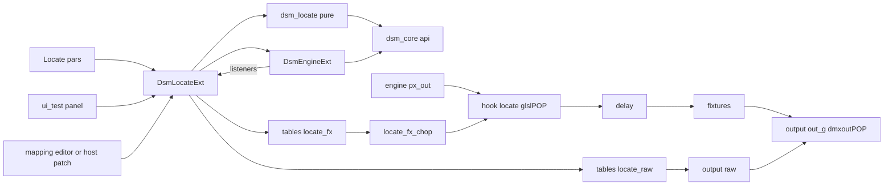
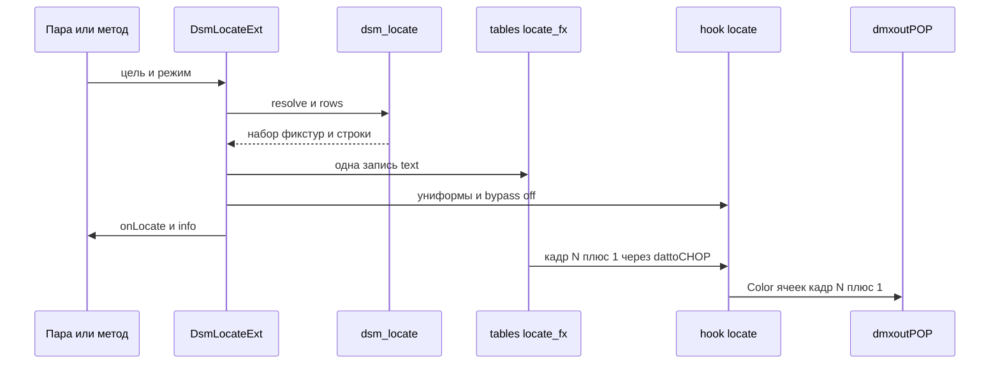
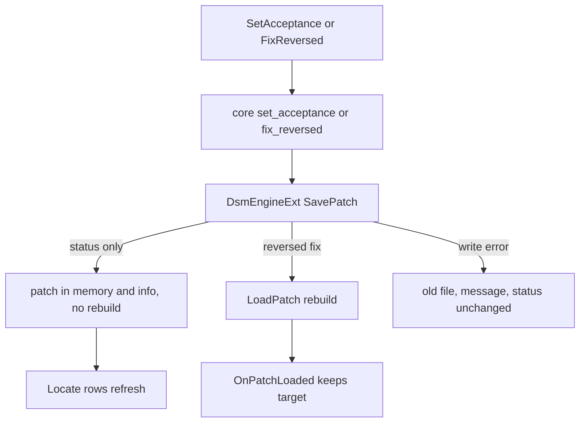

# Design Document — `locate-test`

## Overview

**Purpose**: Locate и тест дают технику площадки способ найти любую фикстуру рига, увидеть её начало, конец и номер
прямо на пикселях, пройти риг по порядку, проверить контроллер сырым адресом и записать результат проверки в патч.
**Users**: техник площадки и светохудожник на монтаже; редакторы `mapping-editor` и `patch-view`, которые вызывают
тот же Locate по клику.
**Impact**: компонент `dsm` получает страницу пар `Locate`, второе расширение `DsmLocateExt`, шейдер в точке `hook`,
цепочку сырого адреса в выводе, панель `ui_test` и колбэк `onLocate`. Расширение движка получает запись патча без
пересборки и внутренний список слушателей загрузки. `Version` 0.1 → 0.2.

### Goals
- Подсветка цели (фикстура, несколько, группа, выход, порт) в режимах мигания, направления, номера и адреса с поведением
  остальных «соло / приглушить / поверх».
- Обход, тест-паттерны, сырой адрес, лист приёмки с записью в файл патча.
- Отклик ≤ 2 кадра, без Python в кадре, +0,3 мс на 20 тыс. ячеек и +0,5 мс на 50 тыс.
- Проверка перехватом байт в байт против эталона из чистого модуля.

### Non-Goals
- Клик по фикстуре на холсте и на карте DMX — `mapping-editor`, `patch-view` (вызывают API этой спеки).
- Управление с телефона — этап 2.
- Гамма, баланс белого, RGBW — `color-power`; генераторы и палитра — `palette-generators`.
- Правка адресов, геометрии, профилей — кроме инверсии направления в «исправить».

## Boundary Commitments

### This Spec Owns
- Разбор цели и режимов Locate, порядок обхода, раскладку номера и адреса на ячейках, тест-паттерны.
- Шейдер `hook/locate` и его входные данные (таблица на фикстуру `tables/locate_fx`, униформы).
- Цепочку сырого адреса `output/raw` и её место последней в списке фикстур узлов вывода.
- Лист приёмки: смену статуса, «исправить», сводку, таблицу и CSV.
- Пары страницы `Locate`, методы `DsmLocateExt`, колбэк `onLocate`, панель `ui_test`.
- Режим `locate` стенда `tools/engine_check.py`.

### Out of Boundary
- Геометрия, таблицы движка, выборка, задержка, профили, маршрутизация — `pixel-engine`; эта спека их не меняет,
  кроме двух расширений `DsmEngineExt` ниже.
- Модель патча и правила ядра — `patch-core`; эта спека только вызывает `set_acceptance`, `fix_reversed`, `save`.
- Клики на холсте и карте DMX, телефон, цветовые преобразования, генераторы.

### Allowed Dependencies
- Ядро `dsm_core` через `dsm_core.api` (только чтение модели и функции правки `set_acceptance`, `fix_reversed`, `save`).
- `DsmEngineExt` (публичные методы и атрибуты `patch`, `issues`, `tables`, новые `SavePatch`, `AddListener`).
- Таблицы движка `tables/*` — только чтение; атрибуты точек `hook` по контракту `docs/engine.md`.
- Узлы TD 2025.33070: `glslPOP`, `dattoCHOP`, `dattoPOP`, `dmxfixturePOP`, `dmxoutPOP` (`fixtureNactive`), `keyboardinDAT`,
  `containerCOMP`, `listCOMP`/lister TDTox.
- Направление: `dsm_core` ← `dsm_locate` (чистый) ← `dsm_locate_ext` (TD) → `DsmEngineExt`. `DsmEngineExt` не импортирует
  и не вызывает Locate.

### Revalidation Triggers
- Изменение атрибутов точки в `hook` (`fx`, `cell`, `active`, `Color`) или порядка точек — перепроверить шейдер Locate.
- Изменение состава и порядка реплик `output/out_g<j>` или их списка `fixture` — перепроверить место сырой фикстуры.
- Изменение `SavePatch` / `AddListener` / `AddInfoProvider` / `WriteInfo` — перепроверить `mapping-editor` и `patch-view`, которые их используют.
- Изменение значений `Acceptance` в ядре — перепроверить лист приёмки и CSV.

## Architecture

### Existing Architecture Analysis
- Таблицы DAT — граница Python/GPU (`pixel-engine`): Python пишет таблицы по событию, кадр идёт по POP без Python.
- `hook` — `in1 → out1` между `engine` и `delay`: точки по одной на ячейку в порядке сегментов, служебные каналы мимо.
- Вывод: реплики `output/out_g<j>` (`dmxoutPOP` на группу выхода), список фикстур заполняет колбэк репликатора,
  `active` и `rate` — константы от `ApplyActive`.
- Расширение движка `DsmEngineExt` — единственный владелец загрузки патча; ошибки → `ReportError` → `onOutputError`.

### Architecture Pattern & Boundary Map



**Architecture Integration**:
- Selected pattern: тот же, что у движка — «Python пишет маленькую таблицу по команде, GPU считает каждый кадр».
  Цель передаётся флагом на фикстуру (таблица на десятки–сотни строк), а не на ячейку.
- Domain boundaries: Locate меняет только `Color` точек в `hook` и добавляет одну фикстуру в вывод; движок про Locate
  не знает, Locate подписывается на загрузку патча слушателем.
- Existing patterns preserved: шаблоны реплик в `templates`, константы узлов от расширения, `info` key/value, колбэки
  через DAT `Callbacks`, DAT синхронизированы с файлами `src/`.
- New components rationale: чистый модуль — для pytest и эталона стенда; отдельное расширение — чтобы `DsmEngineExt`
  не разрастался и не зависел от Locate; шейдер — единственный способ без Python в кадре.
- Steering compliance: движок не знает железа; патч — источник правды (статусы пишутся в патч); Python только по событию.

### Technology Stack

| Layer | Choice / Version | Role in Feature | Notes |
|---|---|---|---|
| Чистая логика | Python 3.11 (TD) / 3.12 (pytest), stdlib | `dsm_locate`: цель, обход, номер, лист приёмки, эталон цвета | без TD-API |
| Слой TD | TouchDesigner 2025.33070, расширение COMP | `DsmLocateExt` на `dsm` (вторая строка расширений) | |
| GPU | `glslPOP` (Arrays: `texturebuffer`, Vectors, readwrite `Color`) | шейдер `src/glsl/locate.glsl` | |
| Вывод | `dattoPOP` → `dmxfixturePOP` → `dmxoutPOP` (последний в списке) | сырой адрес | опыт `spike_raw` |
| UI | `containerCOMP` 1280×720, lister TDTox, `keyboardinDAT.panels` | панель `ui_test` | мануал twozero `panel_layout`, `ui_building`, `lister` |

## File Structure Plan

### Directory Structure
```
src/
├── td/
│   ├── dsm_locate.py           # чистый: Target, LocateState, разбор цели, обход, строки locate_fx,
│   │                           #   раскладка номера/адреса, лист приёмки и CSV, эталон цвета ячейки
│   └── dsm_locate_ext.py       # DsmLocateExt: пары → состояние → таблицы/униформы/обход, сырой адрес,
│                               #   приёмка через DsmEngineExt.SavePatch, onLocate, info Locate
└── glsl/
    └── locate.glsl             # hook/locate: подмена Color по таблице на фикстуру и униформам
tests/
└── test_td_locate.py           # pytest dsm_locate (без TD)
td/stand/
└── locate_test.json            # синтетический патч стенда: 4 фикстуры, группа, 2 выхода, порт, 127.0.0.x
```

### Modified Files
- `src/td/dsm_engine_ext.py` — `SavePatch(edit, rebuild)` (резервная копия при первой записи за сеанс, запись через
  ядро, `loaded_mtime`, без пересборки при `rebuild=False`), `AddListener(fn)` и вызов слушателей в конце `LoadPatch`,
  фильтр предупреждения о наложении каналов в `UpdateCounters`, пока активен сырой адрес (флаг от Locate);
  `AddInfoProvider(fn)` — дополнительные строки `info` от Locate дописываются в каждом `_write_info` (после загрузки,
  в `ReportError`, в `UpdateCounters`), иначе они стирались бы раз в секунду.
- `src/td/dsm_output_callbacks.py` (новый, синхронизированный DAT `output/rep_callbacks`) — колбэк репликатора вывода
  выносится в текст из `.toe`; дописывает сырую фикстуру последней в список фикстур каждой реплики.
- `src/td/dsm_callbacks_default.py` — шаблон `onLocate(target, mode)`.
- `tools/engine_check.py` — режим `locate` (перехват байт в байт против эталона `dsm_locate`, отклик, стоимость кадра,
  лист приёмки на копии патча).
- `docs/engine.md` — страница `Locate`, методы, колбэк, панель, `locate_fx`, сырой адрес; режим `docs` сверяет.
- `CHANGELOG.md`, `README.md` (таблица спек), `.kiro/steering/structure.md` (если появится новый паттерн).
- `td/dsm_dev.toe` (через twozero): `dsm` — страница `Locate`, `ext1` = `DsmLocateExt`, DAT `locate_mod`, `locate_ext`,
  `locate_glsl`; `hook/locate` + `hook/locate_fx_chop`; `tables/locate_fx`, `tables/locate_raw`, `tables/locate_sheet`; `locate_timer` (`timerCHOP` автошага) и `locate_parexec` (`parexecuteDAT` пар `Locate`); `output/raw`
  (`raw_pts`, `raw_prims`, `raw_geo`, `raw_fix`); колбэк репликатора вывода дописывает `raw_fix` последним;
  `ui_test`; `Version = 0.2`; `agents_md`.
- Время шейдера: униформа `uTime` берётся без Python-кука в кадре — проверенный оптимизированный путь выражения
  или канал CHOP времени; факт фиксируется при сборке шейдера.

## System Flows

### Команда Locate → кадр



- Ошибка разбора цели → состояние не меняется, `info.locate_message`, `onOutputError` (1.5).
- Снятие Locate → `bypass` шейдера, контент в следующем кадре (1.4).
- Перезагрузка патча → слушатель `DsmLocateExt.OnPatchLoaded` перестраивает строки по новой цели или снимает Locate (1.9).

### Статус приёмки



## Requirements Traceability

| Requirement | Summary | Components | Interfaces | Flows |
|---|---|---|---|---|
| 1.1, 1.2, 1.3 | цель: фикстура, несколько, группа, выход, порт | `dsm_locate.resolve_target`, `DsmLocateExt.Locate` | `Locate(target, mode)` | Команда → кадр |
| 1.4 | снять за 2 кадра | `DsmLocateExt.Clear`, шейдер `bypass` | `Clear()` | Команда → кадр |
| 1.5, 1.6 | цель не найдена / не выводится | `resolve_target` (`TargetError`, `skipped`) | `info.locate_message`, `onOutputError` | Команда → кадр |
| 1.7 | `onLocate` один раз | `DsmLocateExt._notify` | колбэк `onLocate(target, mode)` | |
| 1.8 | вызов снаружи | пары `Locate`, методы с заглавной | `op('dsm').Locate(...)` | |
| 1.9 | перезагрузка сохраняет цель | `DsmEngineExt.AddListener`, `DsmLocateExt.OnPatchLoaded` | слушатель | Статус приёмки |
| 2.1–2.5 | мигание, соло / приглушить / поверх | `locate.glsl`, униформы `uMode`, `uOthers`, `uDim`, `uBlinkHz`, `uSmooth` | `locate_fx.target` | |
| 2.6 | не трогать отключённые и head/tail | `locate.glsl` (`active == 0` — без изменений), служебные каналы мимо `hook` | | |
| 3.1–3.4 | направление, бег, короткие фикстуры | `locate.glsl` по `cell` и `locate_fx.ncells`, `uRunSec` | | |
| 4.1–4.4 | номер и адрес на пикселях | `dsm_locate.fixture_rows` (`number`, `uni`, `ch`), `locate.glsl` раскладка, второй элемент `number_layout` | `info.locate_message` | |
| 5.1–5.5 | обход и автошаг | `dsm_locate.walk_order`, `step`; `DsmLocateExt.Next/Prev`, `locate_timer` | `Next()`, `Prev()`, пары `Walk*` | |
| 6.1–6.4 | тест-паттерны | `locate.glsl` режимы `fill`, `rgbw`, `chase`; цель = все выводимые | пара `Testpattern` | |
| 7.1–7.6 | сырой адрес | `dsm_locate.raw_rows`, `output/raw`, `DsmLocateExt.Raw/RawClear` | `Raw(...)`, пары `Raw*` | |
| 8.1–8.7 | лист приёмки | `DsmLocateExt.SetAcceptance/FixReversed/ExportSheet`, `dsm_locate.sheet_rows`, `sheet_csv`, `DsmEngineExt.SavePatch` | методы, `tables/locate_sheet` | Статус приёмки |
| 9.1, 9.2 | уровень 30 %, без `Master` | `locate.glsl` (`uLevel`, цвет цели не умножается на `Master`) | пара `Level` | |
| 9.3 | при `Active = Off` не светит | `DsmLocateExt._apply` (сообщение), вывод движка выключен | `info.locate_message` | |
| 9.4, 9.5 | выключен при старте; без Locate байты прежние | `DsmLocateExt.__init__`, `bypass` | | |
| 9.6 | задержка выхода как у контента | шейдер до `delay` | | |
| 10.1 | отклик ≤ 2 кадра | одна запись таблицы + униформы | | Команда → кадр |
| 10.2 | без Python в кадре | шейдер, `absTime` в униформе; таймер обхода — событие | | |
| 10.3 | +0,3 / +0,5 мс | `locate.glsl` с ветвлением по униформе, `bypass` при выключенном | | |
| 10.4 | без пересборки движка | только `locate_fx`, униформы, `fixtureNactive` | | |
| 11.1 | пары страницы `Locate` | компонент `dsm` | см. «Пары» | |
| 11.2, 11.3 | панель TEST и клавиши | `ui_test`, `ui_test/keys` | | |
| 11.4 | `info` Locate | `DsmLocateExt._write_info` → строки `locate_*` в `tables/info` | | |
| 11.5 | контракт 0.1 не ломается, `Version` 0.2 | все | | |
| 12.1 | pytest | `tests/test_td_locate.py` | | |
| 12.2, 12.3, 12.4 | стенд байт в байт, отклик, цена, приёмка | `tools/engine_check.py` режим `locate`, `td/stand/locate_test.json` | | |
| 12.5 | доки и режим `docs` | `docs/engine.md` | | |

## Components and Interfaces

| Component | Domain/Layer | Intent | Req Coverage | Key Dependencies | Contracts |
|---|---|---|---|---|---|
| `dsm_locate` | чистая логика | цель, обход, строки таблиц, номер, лист приёмки, эталон | 1.1–1.6, 4.x, 5.x, 6.1, 7.1, 7.3, 7.4, 8.3, 8.4, 12.1 | `dsm_core.api` (P0) | Service |
| `DsmLocateExt` | слой TD | состояние Locate, запись таблиц и униформ, обход, сырой адрес, приёмка, колбэк | 1.x, 5.x, 7.x, 8.x, 9.3, 9.4, 10.1, 10.2, 11.1, 11.4 | `dsm_locate` (P0), `DsmEngineExt` (P0) | Service, State |
| `DsmEngineExt` (+) | слой TD | запись патча без пересборки, слушатели загрузки | 1.9, 8.1, 8.2, 8.5, 8.6 | `dsm_core.api` (P0) | Service |
| `hook/locate` | GPU | подмена `Color` по цели, режиму и времени | 2.x, 3.x, 4.1, 4.4, 6.x, 9.1, 9.2, 9.5, 9.6, 10.3 | `tables/locate_fx` (P0) | State |
| `output/raw` | вывод | сырой адрес на юниверс выхода | 7.x | реплики `output/out_g<j>` (P0) | State |
| `ui_test` | UI | панель TEST 1280×720 и клавиши | 11.2, 11.3 | `DsmLocateExt` (P0) | — |
| режим `locate` стенда | проверка | перехват, отклик, цена, приёмка | 12.2–12.4 | `dsm_locate` (эталон), `tools/dmx_listen.py` | Batch |

### Чистая логика

#### `dsm_locate`

| Field | Detail |
|---|---|
| Intent | всё, что Locate решает без TD: что подсвечивать и каким цветом должна быть каждая ячейка |
| Requirements | 1.1–1.6, 3.4, 4.1–4.4, 5.1–5.5, 6.1, 7.1, 7.3, 7.4, 8.3, 8.4, 12.1, 12.2 |

**Responsibilities & Constraints**
- Без TD-API и без состояния: функции от `Patch`, `issues`, `segments_by_fixture` ядра.
- Индекс фикстуры `fx` совпадает с индексом в `patch.fixtures` (как в `geo_cells`).
- Порядковый номер фикстуры — индекс + 1.

**Contracts**: Service [x]

##### Service Interface
```python
Mode = Literal["blink", "direction", "number", "address"]
Others = Literal["solo", "dim", "over"]
Pattern = Literal["off", "fill", "rgbw", "chase"]

@dataclass(frozen=True)
class Target:
    spec: str                      # как задано: "fx7", "#12", "name:Стик 3", "group:g1", "output:out1", "port:out1/p1", через запятую
    fixtures: tuple[int, ...]      # индексы выводимых фикстур цели, по порядку патча
    skipped: tuple[tuple[int, str], ...]   # (индекс, причина) — в цели, но не выводятся

class TargetError(ValueError): ...  # .spec, .reason — «нет такой фикстуры / группы / выхода / порта»

def resolve_target(patch: Patch, issues: list[Issue], spec: str) -> Target: ...
def walk_order(patch: Patch, issues: list[Issue], only_unchecked: bool) -> list[int]: ...
def step(order: list[int], current: int | None, delta: Literal[1, -1], loop: bool) -> int | None: ...

@dataclass(frozen=True)
class FxRow:                       # строка tables/locate_fx, одна на фикстуру патча
    fx: int; target: int; number: int; uni: int; ch: int; ncells: int; offset: int

def fixture_rows(patch: Patch, segments: dict[str, list[Segment]], target: Target | None, issues: list[Issue] = ()) -> list[FxRow]: ...
def number_layout(number: int, ncells: int) -> tuple[list[str], bool]: ...   # цвета ячеек от начала, помещается ли
def address_layout(universe: int, channel: int, ncells: int) -> tuple[list[str], bool]: ...  # юниверс, две off, канал
def raw_rows(patch: Patch, output_id: str, universe: int, first: int, last: int, value: int) -> RawRows: ...  # RawError при ошибке
def sheet_rows(patch: Patch, segments: dict[str, list[Segment]]) -> list[list[str]]: ...  # заголовок + строка на фикстуру
def sheet_summary(patch: Patch) -> dict[str, int]: ...
def sheet_csv(rows: list[list[str]]) -> str: ...
def expected_color(state: LocateState, row: FxRow, cell: int, content: tuple[float, float, float], t: float) -> tuple[float, float, float]: ...
```
- Preconditions: патч загружен ядром; `segments` — `segments_by_fixture(patch)`.
- Postconditions: `resolve_target` не возвращает пустую цель — пустая цель без пропусков → `TargetError`.
- Invariants: `fixture_rows` — по строке на каждую фикстуру патча, в порядке `patch.fixtures`; `offset` — сумма `ncells`
  предыдущих выводимых фикстур (для `chase`); у не выводимых `ncells = 0`.

**Implementation Notes**
- Validation: pytest — разбор каждого вида цели и ошибок, обход с пропусками и `only_unchecked`, раскладка номера
  (0, 7, 10, 105, 999, нехватка ячеек), `raw_rows` границы, лист приёмки и CSV (`;` и запятая как в ядре), эталон цвета.
- Risks: имена фикстур с запятыми — разделитель списка `,` экранируется префиксом вида цели на каждом элементе.

### Слой TouchDesigner

#### `DsmLocateExt`

| Field | Detail |
|---|---|
| Intent | связать пары, методы и панель с таблицами, униформами и выводом; хранить состояние Locate |
| Requirements | 1.1–1.9, 5.1–5.5, 6.2–6.4, 7.1–7.6, 8.1–8.7, 9.3, 9.4, 10.1, 10.2, 10.4, 11.1, 11.4 |

**Responsibilities & Constraints**
- Состояние — атрибуты экземпляра (`self.state`), не `op.store`; при инициализации Locate выключен (9.4).
- Каждая команда: разбор → одна запись `tables/locate_fx` (`text`) → униформы шейдера → `bypass` → `info` → `onLocate`.
- Не трогает таблицы движка, геометрию и реплики; единственная запись в вывод — `fixtureNactive` сырой фикстуры.
- Тест-паттерн и подсветка цели взаимоисключающие (6.4); сырой адрес независим от них.

**Dependencies**
- Outbound: `dsm_locate` — логика (P0); `DsmEngineExt.SavePatch`, `.patch`, `.issues`, `AddListener` (P0).
- Inbound: пары `Locate` (`parexecuteDAT` → методы), `ui_test`, внешние вызовы (P0).

**Contracts**: Service [x] / State [x]

##### Service Interface
```python
class DsmLocateExt:
    def Locate(self, target: str, mode: Mode | None = None) -> bool: ...   # False + сообщение при TargetError
    def Clear(self) -> None: ...
    def Next(self) -> None: ...
    def Prev(self) -> None: ...
    def Walk(self, on: bool) -> None: ...                                   # автошаг
    def Test(self, pattern: Pattern) -> None: ...
    def Raw(self, output_id: str, universe: int, first: int, last: int, value: int) -> bool: ...
    def RawClear(self) -> None: ...
    def SetAcceptance(self, fixture_id: str, status: str) -> bool: ...
    def FixReversed(self, fixture_id: str) -> bool: ...
    def ExportSheet(self, path: str | None = None) -> str: ...            # по умолчанию <патч>_acceptance.csv рядом с патчем
    def OnPatchLoaded(self, patch: Patch, issues: list[Issue]) -> None: ...  # слушатель движка
```
- Postconditions: `Locate` при успехе меняет вывод не позже следующего кадра после записи (10.1); при ошибке
  состояние прежнее (1.5).

##### State Management
- `LocateState(target: Target | None, mode, others, level, dim, blink_hz, smooth, pattern, test_color, walk: bool,
  walk_loop, walk_unchecked, walk_step_s, raw: RawState | None, message)`.
- Пары страницы `Locate` — отражение состояния: метод меняет пару, пара через `parexecuteDAT` вызывает метод
  (защита от повторного входа флагом).

**Implementation Notes**
- Integration: регистрирует `OnPatchLoaded` через `parent.dsm.ext.DsmEngineExt.AddListener` в `__init__`; таймер обхода —
  `timerCHOP` 1 цикл = шаг, колбэк `onCycle` → `Next` (событие, не кук кадра).
- Validation: стенд `locate` (12.2–12.4), `td_get_errors` после правок.
- Risks: ext1 на том же COMP — проверить промоут методов без конфликта имён с `DsmEngineExt`.

#### `DsmEngineExt` (расширение)

| Field | Detail |
|---|---|
| Intent | единственный владелец записи файла патча; события загрузки внутри компонента |
| Requirements | 1.9, 8.1, 8.2, 8.5, 8.6 |

##### Service Interface
```python
def SavePatch(self, edit: Callable[[Patch], Patch], rebuild: bool) -> bool: ...   # False + сообщение в info и onOutputError
def AddListener(self, fn: Callable[[Patch, list[Issue]], None]) -> None: ...
def SetCounterFilter(self, text: str | None) -> None: ...      # подстрока предупреждения узла, которую не передавать
def AddInfoProvider(self, fn: Callable[[], list[list[str]]]) -> None: ...  # строки key/value, дописываются в info
def WriteInfo(self) -> None: ...                               # переписать info сейчас (после команды Locate)
```
- Патч для записи — документ, заново прочитанный из файла (`api.load`, до автоадресации), с той же правкой; правка
  применяется и к рабочему патчу в памяти. Иначе в файл ушли бы адреса, раздаваемые автоадресацией (8.7).
  Метод: `SavePatch(edit: Callable[[Patch], Patch], rebuild)` — функция правки применяется к обоим.
- `SavePatch`: при первой записи за сеанс копирует файл в `<имя>.bak.json` рядом; `api.save` (временный файл); при успехе
  `loaded_mtime` = новая дата; `rebuild=False` — рабочий патч = `edit(self.patch)`, `issues` и таблицы прежние, `info` без пересборки; `rebuild=True` — `LoadPatch`.
  Ошибка записи — прежний файл, сообщение в `info` и `onOutputError` без смены статуса движка (вывод не
  останавливается), патч в памяти не меняется, временный файл ядра удаляется (8.5). Пишется файл загруженного
  патча (`patch_path`), а не пары `Patchfile`.
- `LoadPatch` в конце вызывает слушателей (исключение слушателя — в textport, загрузка не прерывается).

#### `hook/locate` (GPU)

| Field | Detail |
|---|---|
| Intent | подменить `Color` ячеек по цели и режиму каждый кадр без Python |
| Requirements | 2.1–2.6, 3.1–3.4, 4.1, 4.4, 6.1–6.3, 9.1, 9.2, 9.5, 9.6, 10.2, 10.3 |

**Contracts**: State [x]

##### State Management (входы шейдера)
- Точки `hook/in1`: `fx`, `cell`, `active`, `Color` (readwrite); остальные атрибуты проходят без изменений.
- Массив `uFx` (`texturebuffer`, `vec4` на фикстуру): `(target, number, ncells, offset)`; массив `uAddr` (`vec2`): `(uni, ch)`.
  Источник — `tables/locate_fx` → `hook/locate_fx_chop` (`dattoCHOP`, каналы по колонкам, сэмпл = фикстура).
- Униформы: `uMode` (0 blink, 1 direction, 2 number, 3 address, 4 fill, 5 rgbw, 6 chase), `uOthers` (0 solo, 1 dim, 2 over),
  `uLevel`, `uDim`, `uBlinkHz`, `uSmooth`, `uRunSec`, `uTestColor`, `uTime` (= `absTime.seconds`), `uFreeze` (−1 — живое
  время; ≥ 0 — фиксированное время для стенда), `uTotal` (сумма ячеек для `chase`).
- Правила: `active == 0` → `Color` без изменений (2.6); цель → цвет режима × `uLevel`, без `Master` (9.2); остальные →
  0 / `Color × uDim` / `Color`; режимы паттернов — все выводимые как цель.
- `bypass = True`, когда Locate и паттерн выключены (9.5, 10.3).

**Implementation Notes**
- Validation: стенд сравнивает перехват с `dsm_locate.expected_color` при `uFreeze` фиксированных фаз.
- Risks: цена на 50 тыс. — замер; ветвление только по униформам.

#### `output/raw`

| Field | Detail |
|---|---|
| Intent | слать значение на каналы юниверса выхода в обход патча |
| Requirements | 7.1–7.6 |

- `tables/locate_raw` (точки: 512 ячеек по одному каналу, значение / 255 на каналах `first..last`, 0 на остальных;
  примитив: юниверс, канал 1, адрес выхода) → `output/raw/raw_geo` (`dattoPOP`) → `raw_fix` (`dmxfixturePOP`, блок
  `Color(0)`, 1 канал на ячейку).
- Колбэк репликатора вывода дописывает `raw_fix` последним в список `fixture` каждого `out_g<j>` с `fixtureNactive = False`;
  `DsmLocateExt.Raw` включает его только у группы выхода цели (последний в списке перекрывает юниверс — опыт `spike_raw`).
- Пока сырой адрес активен, `SetCounterFilter("Multiple fixtures using the same channels")`.

#### `ui_test` (UI, summary)
- `containerCOMP` 1280×720 внутри `dsm`: список фикстур (lister TDTox) с поиском по имени и номеру и статусом приёмки;
  выбор группы / выхода / порта; кнопки режимов, поведения остальных, обхода; уровень; статусы `ok / reversed / dead /
  misplaced / wrong_address / none`, «исправить», сводка, «экспорт CSV»; сырой адрес; тест-паттерны.
- `ui_test/keys` (`keyboardinDAT`, `panels = ui_test`): `→ / ←` — следующая / предыдущая, `1–4` — режимы, `O / R / D` —
  статусы `ok / reversed / dead`, `Esc` — снять.
- Только вызывает методы `DsmLocateExt`; своего состояния нет. Окно — пара `Testwindow` (`windowCOMP` на `ui_test`).
- Implementation Note: перед сборкой — мануал twozero `panel_layout`, `ui_building`, `lister`; `td_audit_panel`.

## Data Models

### Пары страницы `Locate`

| Пара | Тип | По умолчанию | Смысл |
|---|---|---|---|
| `Target` | Str | пусто | цель; смена → `Locate` |
| `Mode` | Menu `blink / direction / number / address` | `blink` | режим |
| `Others` | Menu `solo / dim / over` | `solo` | остальные |
| `Level` | Float 0–1 | 0,3 | уровень Locate |
| `Dim` | Float 0–1 | 0,2 | множитель «приглушить» |
| `Blinkhz` | Float | 2 | частота мигания |
| `Blinksmooth` | Toggle | выкл. | плавное мигание (синус) |
| `Runsec` | Float 1–3 | 2 | проход бегущей ячейки |
| `Clear` | Pulse | | снять Locate и паттерн |
| `Next` / `Prev` | Pulse | | обход |
| `Walk` | Toggle | выкл. | автошаг |
| `Walkstep` | Float | 3 | интервал автошага, с |
| `Walkloop` | Toggle | вкл. | по кругу / стоп на последней |
| `Walkunchecked` | Toggle | выкл. | только непроверенные |
| `Testpattern` | Menu `off / fill / rgbw / chase` | `off` | тест-паттерн |
| `Testcolor` | RGB | 1, 1, 1 | цвет заливки |
| `Rawoutput` | Str | пусто | `id` выхода для сырого адреса |
| `Rawuniverse` | Int | 0 | юниверс |
| `Rawfirst` / `Rawlast` | Int 1–512 | 1 / 512 | каналы |
| `Rawvalue` | Int 0–255 | 255 | значение |
| `Rawactive` | Toggle | выкл. | сырой адрес вкл. |
| `Testwindow` | Toggle | выкл. | окно панели TEST |

### `tables/locate_fx`
Колонки `fx target number uni ch ncells offset` — по строке на фикстуру патча (`FxRow`).

### Строки `info` Locate
`locate_target`, `locate_mode`, `locate_others`, `locate_walk` (`off / on N из M`), `locate_raw` (`off / out1 u0 1–512 = 255`),
`locate_pattern`, `locate_message`, `acceptance_<статус>` (сводка). Пишутся через `AddInfoProvider` движка.
- После перезагрузки патча (реплики вывода пересоздаются) `OnPatchLoaded` заново включает сырой адрес у новой реплики
  группы выхода, когда реплики появились, или снимает его с сообщением, если выхода нет в новом патче.

### Лист приёмки (`tables/locate_sheet`, CSV)
`n` (порядковый), `id`, `name`, `output`, `universe`, `channel`, `status` — по строке на фикстуру; CSV — разделитель `;`,
UTF-8, рядом с патчем `<имя патча>_acceptance.csv`.

## Error Handling

### Error Strategy
- Ошибки команды (цель, сырой адрес вне границ, выход не найден, нет статуса) — команда отклоняется целиком, состояние
  и вывод прежние, `info.locate_message` + `onOutputError` (1.5, 7.4).
- Фикстура в цели не выводится — подсвечиваются остальные, причина в `info` (1.6); номер не помещается — разряды со
  старшего, сообщение (4.3).
- Ошибка записи файла патча — `SavePatch` возвращает `False`, прежний файл, статус в памяти прежний (8.5).
- Исключение в колбэке `onLocate` — textport, Locate работает.
- `Active = Off` — Locate принимает команды, но в `info` «вывод выключен» (9.3).

### Monitoring
- `info` строки `locate_*` обновляются при каждой команде и в `UpdateCounters` (1 Гц) для обхода.

## Testing Strategy

- **Unit (`tests/test_td_locate.py`)**: `resolve_target` — все виды цели, несколько, пустая, несуществующая, не выводимая
  фикстура; `walk_order` и `step` — по кругу, стоп, пропуск не выводимых, `only_unchecked`; `number_layout` — 0, 7, 10, 105,
  999 и нехватка ячеек; `raw_rows` — границы каналов и значения, юниверс вне патча; `sheet_rows`/`sheet_csv`/`sheet_summary`;
  `expected_color` — каждый режим × остальные × `active = 0`.
- **Integration (стенд `locate`, `td/stand/locate_test.json`)**: перехват Art-Net / sACN unicast байт в байт против
  `expected_color` + `quantize8` для мигания (фазы вкл. и выкл. через `uFreeze`), соло / приглушить / поверх, направление
  (первая, последняя, бегущая в фиксированной фазе), номер и адрес, `fill` / `rgbw` / `chase`, сырой адрес (юниверс
  перекрыт, остальные юниверсы как у движка), выключенный Locate = байты движка (9.5).
- **Отклик и цена**: кадр команды → кадр, где перехват видит новые байты (≤ 2); `perf`-проход с Locate выкл. и вкл.
  на 20 016 и 49 968 ячейках — прирост ≤ 0,3 / 0,5 мс (10.3).
- **Лист приёмки**: на копии патча в `td/stand/reports/` — `SetAcceptance` пишет только `acceptance` (сравнение JSON без
  поля), без пересборки (`totalCooks` `engine/pts_cells` не растёт); `FixReversed` — направление инвертировано,
  статус `none`, после перезагрузки «направление» красная ячейка с другого конца; ошибка записи (файл только для чтения) —
  прежний файл и сообщение.
- **Документация**: режим `docs` — пары страницы `Locate` и операторы `hook/locate`, `output/raw`, `ui_test` из `docs/engine.md`.

## Performance & Scalability
- Цель — флаг на фикстуру: запись `locate_fx` — сотни строк (≤ 1 мс Python), а не десятки тысяч.
- Шейдер в обходе при выключенном Locate — 0 мс; при включённом — один проход по точкам, без выборки текстур.
- Сырая фикстура выключена (`fixtureNactive = False`) — вклад в `dmxoutPOP` нулевой (проверка замером).
