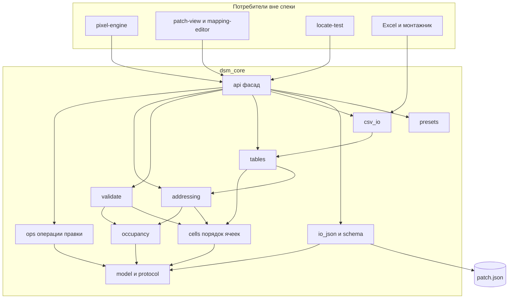
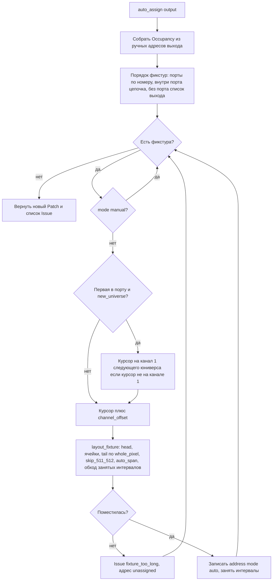

# Design Document — `patch-core`

## Overview

**Purpose**: `patch-core` — ядро Diod Sticks Mapper: модель патча, JSON-документ с версией схемы,
адресация по правилам выхода и порта, проверки конфликтов, таблицы адресов и маршрутизации,
CSV. Всё на чистом Python 3.11 (stdlib), без TouchDesigner, проверяется pytest.

**Users**: следующие спеки проекта (`pixel-engine`, `patch-view`, `mapping-editor`, `locate-test`,
`fixture-editor`) — они правят патч только через операции ядра; техник и светохудожник — через CSV
и примеры патчей.

**Impact**: создаёт пакет `dsm_core` в `src/core`, тесты в `tests`, примеры в `examples`,
документацию формата и API в `docs`. Существующий код не меняется (ядро — первый код проекта).

### Goals
- Патч — один детерминированный JSON-документ, источник правды (1.x).
- Адресация воспроизводима и совпадает с поведением движка TD при правилах по умолчанию (6.x, 8.3).
- Все конфликты — одним списком с id объектов (7.x).
- Таблицы и CSV готовы для `DMX Map DAT`, монтажника и Excel (8.x, 9.x).
- Тесты pytest на каждое правило, порог 1 с на 50 000 ячеек (6.14, 11.x).

### Non-Goals
- Позиции ячеек на холсте, выборка цвета, GLSL/POP, DMX-вывод — `pixel-engine`.
- Интерфейс, undo/redo — `patch-view`, `mapping-editor`.
- Импорт пресетов Resolume — отдельная спека `resolume-import` (отложено заказчиком).
- Лист патча HTML/MD, 3D, цвет и мощность — этапы 2–3.
- Расчёт по `curve`, `arc`, `custom` — только валидация схемы.

## Boundary Commitments

### This Spec Owns
- Модель патча и её JSON-схема (`schema_version = 1`), миграции, сериализация.
- Порядок ячеек фикстуры в данных (раскладки матрицы, `reverse`, `cell_offset`, `disabled`, `every_n`).
- Авто- и ручная адресация, правила выхода и порта, занятость каналов.
- Проверки конфликтов и их коды.
- Таблицы: адресов, по ячейкам, сегментов, маршрутизации, сводка; CSV туда и обратно.
- Встроенные пресеты профилей и чисел портов (данные).
- Публичный API `dsm_core.api`; документация `docs/patch-format.md`, `docs/core-api.md`.
- Примеры патчей `examples/*.json`.

### Out of Boundary
- Координаты ячеек, UV, геометрия POP, атрибуты примитивов — `pixel-engine` (читает таблицу сегментов).
- Любой код под TouchDesigner (`src/td`), любой Python каждый кадр.
- Undo/redo, выделение, холст — спеки интерфейса (поверх функций ядра).
- Импорт Resolume XML — `resolume-import` (использует `api.add_fixture_type`/`add_output`/`add_fixture`).
- Сеть: ядро не открывает сокеты, не проверяет доступность IP.

### Allowed Dependencies
- Только стандартная библиотека Python 3.11: `json`, `csv`, `dataclasses`, `enum`, `ipaddress`,
  `pathlib`, `typing`, `copy`, `math`, `io`.
- Для тестов — `pytest` (dev-зависимость, не импортируется ядром).
- Направление зависимостей внутри пакета (слева направо, никогда обратно):
  `errors → model → protocol → cells → schema → io_json → occupancy → addressing → validate → tables → csv_io → presets → api`.

### Revalidation Triggers
- Изменение формы `Segment` или колонок таблицы адресов/сегментов → перепроверить `pixel-engine`.
- Новый `schema_version` или переименование поля JSON → миграция + перепроверить все спеки, читающие патч.
- Изменение кодов конфликтов (`IssueCode`) → `patch-view` (подсветка), `locate-test`.
- Изменение сигнатур `dsm_core.api` → все потребители.
- Смена правила по умолчанию (`whole_pixel`, `auto_span`, `skip_511_512`) → стенд TD, тест 11.4.

## Architecture

### Architecture Pattern & Boundary Map



**Architecture Integration**:
- Паттерн: **функциональное ядро** — модель на `dataclasses` (frozen), операции — чистые функции
  `f(patch, …) → Patch` (новый объект, старый не трогается). Атомарность 10.2 бесплатна: исключение
  до возврата = патч не изменён.
- Границы: `model` ничего не считает; `cells` знает только профиль и фикстуру; `addressing` не знает
  про CSV и таблицы; `tables` не меняют патч; `api` — единственная точка входа для потребителей.
- Steering: stdlib only, нет абсолютных путей, Python только при правке патча, контроллер — данные.

### Technology Stack

| Layer | Choice / Version | Role in Feature | Notes |
|---|---|---|---|
| Ядро | Python 3.11 syntax, stdlib | модель, адресация, таблицы, CSV | работает на системном 3.12 и встроенном в TD 3.11 |
| Данные | JSON (`json`), CSV (`csv`) | патч, обмен | детерминированная запись |
| Тесты | pytest ≥ 8 | проверка ядра вне TD | `pip install pytest`; `pyproject.toml` задаёт `pythonpath = ["src/core"]` |
| Проверка синтаксиса | `ast.parse(feature_version=(3, 11))` | гарантия 11.2 | тест компилирует все модули ядра как 3.11 |

## File Structure Plan

### Directory Structure
```
pyproject.toml                      # только [tool.pytest.ini_options]: pythonpath, testpaths
src/core/dsm_core/
├── __init__.py                     # __version__ ядра, реэкспорт api
├── errors.py                       # PatchError, SchemaError(path, reason), OperationError, CsvError
├── model.py                        # dataclasses патча: Patch, Canvas, FixtureType, ChannelBlock, Channel,
│                                   #   Fixture, Shape*, Address, Output, Port, Group, перечисления; extra-поля
├── protocol.py                     # Art-Net port-address ↔ net.subnet.universe, границы sACN, multicast-группа
├── cells.py                        # порядок ячеек: 16 раскладок, reverse, cell_offset, disabled, every_n
├── schema.py                       # SCHEMA_VERSION, валидация dict → список SchemaError с путями, умолчания
├── migrations.py                   # MIGRATIONS: list[(from_version, fn)] — пока пусто
├── io_json.py                      # load/loads/save/dumps: детерминированная запись, extra-поля, миграции
├── ids.py                          # генерация id: префикс + max+1
├── occupancy.py                    # Occupancy: интервалы каналов на (output, universe), пересечения
├── addressing.py                   # layout_fixture (сегменты), auto_assign, assign_sequential, правила
├── validate.py                     # validate(patch) → list[Issue]; IssueCode
├── tables.py                       # address_table, cell_table, segment_table, routing_table, summary; Rows
├── csv_io.py                       # экспорт/импорт CSV фикстур, экспорт таблиц, диалекты , и ;
├── presets.py                      # FIXTURE_PRESETS, PORT_PRESETS (данные)
├── ops.py                          # add/update/remove профилей, фикстур, выходов, портов, групп; duplicate;
│                                   #   set_manual_address, set_acceptance, fix_reversed
└── api.py                          # публичный фасад: реэкспорт функций + new_patch()
tests/
├── conftest.py                     # фабрики патчей: stage0_patch, sticks_patch, matrix_patch
├── test_syntax_311.py              # 11.2: ast.parse всех модулей с feature_version 3.11
├── test_model_json.py              # 1.x, 2.x: круговой обход, детерминизм, схема, миграции, extra
├── test_cells.py                   # 3.6, 3.7, 4.4–4.8: раскладки, reverse, сдвиги, disabled, every_n
├── test_protocol.py                # 5.4, 5.5: 20 ↔ 0.1.4, границы
├── test_addressing.py              # 6.x: каждое правило, этап 0 (200/60/128), ручные, блок, подряд
├── test_validate.py                # 7.x: каждый код конфликта
├── test_tables.py                  # 8.x: таблицы, сводка, формат строк для DAT
├── test_csv.py                     # 9.x: экспорт, импорт, обновление по id, ошибки строк, ; и запятая
├── test_ops.py                     # 4.9–4.11, 10.x: операции, атомарность, битые ссылки
├── test_presets.py                 # 3.12, 5.9: пресеты валидны
├── test_examples.py                # 11.6: examples/*.json загружаются без error, цель 127.0.0.1
└── test_perf.py                    # 6.14: 50 000 ячеек ≤ 1 с, 20 000 ≤ 0,3 с
examples/
├── strip_ws2812b.json              # одна лента 300 px, один выход Art-Net
├── sticks_8x_artnet.json           # 8 стиков 144 px на одном выходе с портами
├── matrix_16x16_sacn.json          # матрица 16×16, sACN multicast
└── bar_common_channels.json        # бар: общие каналы + 8 ячеек + хвост
docs/
├── patch-format.md                 # формат JSON по полям, умолчания, версия
└── core-api.md                     # публичные функции api.py, таблицы, коды конфликтов
```

### Modified Files
- `README.md` — раздел «Структура»: `src/core/dsm_core`, команда тестов; `CHANGELOG.md` — запись спеки.
- `.kiro/steering/structure.md` — пример пути ядра `src/core/dsm_core/addressing.py`.

## System Flows

### Автоадресация выхода


Решения потока:
- Курсор (юниверс, канал) идёт только вперёд; занятые ручными адресами интервалы перепрыгиваются целиком.
- `layout_fixture` — одна функция и для авто, и для ручного адреса (таблицы и проверки считают сегменты ею же),
  поэтому таблица 8.1 всегда согласована с правилами.
- Лимиты порта не влияют на раскладку — только на проверку (`validate`).

### Раскладка одной фикстуры (`layout_fixture`)
Вход: профиль, фикстура, стартовые `(universe, channel)`, правила выхода, занятость.
Выход: `list[Segment]`, где сегмент — непрерывный блок каналов одного юниверса:
`(universe, first_channel, last_channel, kind ∈ {head, cells, tail}, first_cell, n_cells)`.
Правила:
1. Верхняя граница юниверса `limit = 510`, если `skip_511_512`, иначе `512`.
2. `head` и `tail` — неделимые блоки; ячейка — неделимый блок `channels_per_cell` при `whole_pixel`.
3. Блок, не влезающий до `limit` или упирающийся в занятый интервал, переносится на первый свободный
   канал после препятствия; при переходе юниверса — канал 1 следующего (`auto_span`), иначе — ошибка.
4. При `whole_pixel = false` ячейка режется по границе юниверса (сегменты по каналам, `n_cells` дробится
   в `first_cell`/`n_cells` соседних сегментов как частичные — помечается `partial = true`).
5. `channel_offset` применяется до `head` только при автоадресации; у ручного адреса стартовый канал уже задан.

## Requirements Traceability

| Requirement | Summary | Components | Interfaces | Flows |
|---|---|---|---|---|
| 1.1–1.2 | разделы JSON, стабильные id | model, ids | `Patch`, `new_id` | — |
| 1.3 | детерминированная запись | io_json | `dumps` | — |
| 1.4 | валидация с путём | schema | `validate_document` | — |
| 1.5–1.6 | миграции, новее — отказ | migrations, io_json | `loads` | — |
| 1.7 | неизвестные поля сохраняются | model.extra, io_json | — | — |
| 1.8–1.9 | пустой патч, относительные пути | api.new_patch, schema | — | — |
| 2.1–2.3 | холст | model.Canvas, schema | — | — |
| 3.1–3.5, 3.8–3.9 | профиль, блоки, порядок цвета, битность | model.FixtureType, schema | `channels_per_cell`, `total_channels` | — |
| 3.6–3.7 | раскладки матрицы, custom | cells | `cell_order` | — |
| 3.10–3.11 | правка/удаление профиля | ops | `update_fixture_type`, `remove_fixture_type` | — |
| 3.12 | пресеты профилей | presets | `FIXTURE_PRESETS` | — |
| 4.1–4.3 | поля фикстуры, формы, выборка | model.Fixture, Shape, schema | — | — |
| 4.4–4.7 | reverse, сдвиги, disabled, every_n | cells, addressing | `cell_order`, `layout_fixture` | раскладка |
| 4.8 | ячейки из длины ленты | model.FixtureType, cells | `cell_count` | — |
| 4.9 | статус приёмки, fix_reversed | ops | `set_acceptance`, `fix_reversed` | — |
| 4.10 | дубль | ops | `duplicate_fixtures` | — |
| 4.11 | группы | model.Group, ops | `add_group` … | — |
| 5.1–5.3 | выход, цель, 127.0.0.1 | model.Output, tables, validate | `routing_table`, `Issue target_missing` | — |
| 5.4–5.5 | нумерация Art-Net/sACN | protocol | `to_port_address`, `from_port_address` | — |
| 5.6 | правила выхода | model.OutputRules, addressing | `layout_fixture` | раскладка |
| 5.7 | порты | model.Port, addressing, validate | — | автоадресация |
| 5.8 | несколько выходов на IP | validate | `universe_dup` | — |
| 5.9 | пресеты портов | presets | `PORT_PRESETS` | — |
| 6.1–6.9 | авто по правилам | addressing | `auto_assign` | автоадресация |
| 6.10 | ручные не трогаются | occupancy, addressing | — | автоадресация |
| 6.11–6.12 | блок, подряд | addressing | `assign_sequential` | — |
| 6.13 | детерминизм | addressing | — | — |
| 6.14 | 1 с / 0,3 с | occupancy (интервалы), tables (кортежи) | — | — |
| 7.1–7.13 | проверки | validate | `validate`, `Issue`, `IssueCode` | — |
| 8.1–8.6 | таблицы, сводка | tables | `address_table`, `cell_table`, `segment_table`, `routing_table`, `summary` | — |
| 9.1–9.7 | CSV | csv_io | `export_fixtures_csv`, `import_fixtures_csv`, `rows_to_csv` | — |
| 10.1 | набор операций | api, ops | `api.*` | — |
| 10.2 | атомарность | ops (функциональный стиль) | — | — |
| 10.3 | без побочных эффектов | все модули | — | — |
| 10.4 | строки для DAT | tables.Rows | — | — |
| 11.1–11.2 | stdlib, 3.11 | tests/test_syntax_311 | — | — |
| 11.3–11.5 | pytest, правила, круговой обход | tests/* | — | — |
| 11.6 | примеры | examples/, tests/test_examples | — | — |
| 11.7 | без реальных данных | все; IP только 127.0.0.x, 192.0.2.x | — | — |
| 11.8 | документация | docs/patch-format.md, docs/core-api.md | — | — |

## Components and Interfaces

| Component | Layer | Intent | Req Coverage | Key Dependencies | Contracts |
|---|---|---|---|---|---|
| model | данные | типы патча, инварианты полей | 1, 2, 3, 4, 5 | errors (P0) | State |
| protocol | данные | нумерация юниверсов протоколов | 5.4, 5.5 | — | Service |
| cells | логика | порядок ячеек в данных | 3.6, 3.7, 4.4–4.8 | model (P0) | Service |
| schema + migrations | данные | dict ↔ проверка, умолчания, версии | 1.4–1.7, 2, 3, 4, 5 | model (P0) | Service |
| io_json | ввод-вывод | загрузка/сохранение | 1.3, 1.5–1.7, 1.9 | schema (P0) | Service |
| ids | данные | генерация id | 1.2 | model | Service |
| occupancy | логика | занятость каналов | 6.10, 7.2, 6.14 | model (P0) | State |
| addressing | логика | раскладка и авто | 5.6, 5.7, 6.x | cells, occupancy (P0) | Service |
| validate | логика | конфликты | 5.3, 5.8, 7.x | addressing, occupancy (P0) | Service |
| tables | вывод | таблицы и сводка | 8.x, 10.4 | addressing, cells (P0) | Service |
| csv_io | ввод-вывод | CSV | 9.x | tables, ops (P0) | Service |
| presets | данные | встроенные пресеты | 3.12, 5.9 | model | State |
| ops | логика | операции правки | 3.10–3.11, 4.9–4.11, 10.2 | model, ids (P0) | Service |
| api | фасад | единая точка входа | 10.1 | все (P0) | Service |

### Данные

#### model

| Field | Detail |
|---|---|
| Intent | неизменяемые dataclasses патча и перечисления; никаких вычислений кроме производных свойств профиля |
| Requirements | 1.1, 1.2, 1.7, 2.1–2.3, 3.1–3.5, 3.8–3.9, 4.1–4.6, 4.11, 5.1–5.2, 5.6–5.7 |

**Responsibilities & Constraints**
- Все классы `@dataclass(frozen=True, slots=True)`; изменение — `dataclasses.replace`.
- Каждый объект с id имеет `extra: dict[str, object]` для неизвестных полей (1.7).
- Инварианты полей (диапазоны, допустимые строки) проверяет `schema`, а не конструкторы —
  конструкторы доверяют вызывающему (модель создаётся только из `schema.from_dict` и `ops`).

##### State Management — типы (Python, сокращённо; полный список полей — `docs/patch-format.md`)
```python
class Protocol(str, Enum): ARTNET = "artnet"; SACN = "sacn"
class TargetKind(str, Enum): UNICAST = "unicast"; BROADCAST = "broadcast"; MULTICAST = "multicast"
class FixtureKind(str, Enum): STRIP = "strip"; STICK = "stick"; MATRIX = "matrix"; BAR = "bar"; CUSTOM = "custom"
class AddressMode(str, Enum): AUTO = "auto"; MANUAL = "manual"; UNASSIGNED = "unassigned"
class Direction(str, Enum): FORWARD = "forward"; REVERSE = "reverse"
class Acceptance(str, Enum): NONE = "none"; OK = "ok"; REVERSED = "reversed"; DEAD = "dead"; MISPLACED = "misplaced"; WRONG_ADDRESS = "wrong_address"
class MatrixLayout(str, Enum):  # 16 значений: угол старта × первая линия × змейка
    TL_ROWS = "tl_rows"; TL_ROWS_SNAKE = "tl_rows_snake"; TL_COLS = "tl_cols"; TL_COLS_SNAKE = "tl_cols_snake"
    TR_ROWS = "tr_rows"; ...; BR_COLS_SNAKE = "br_cols_snake"

@dataclass(frozen=True, slots=True)
class Channel:            # один DMX-канал блока
    name: str             # "R", "G", "B", "W", "A", "dim", "strobe", "pan", "tilt", произвольное
    role: str             # "color" | "control"
    default: int = 0      # 0–255 (для 16 бит — старшие 8)
    bits: int = 8         # 8 | 16 (16 = два DMX-канала)

@dataclass(frozen=True, slots=True)
class ChannelBlock:
    channels: tuple[Channel, ...]
    @property
    def width(self) -> int: ...          # сумма (1 или 2) по каналам

@dataclass(frozen=True, slots=True)
class FixtureType:
    id: str; name: str; kind: FixtureKind
    cells: int                            # число ячеек (для matrix = width*height)
    width: int = 1; height: int = 1       # matrix
    layout: MatrixLayout = MatrixLayout.TL_ROWS
    custom_cells: tuple[tuple[float, float], ...] = ()   # kind custom: относительные позиции
    color_order: str = "RGB"              # буквы R G B W A, порядок в блоке ячейки
    bits: int = 8
    head: ChannelBlock = ChannelBlock(()) # общие каналы прибора
    cell_extra: ChannelBlock = ChannelBlock(())  # нецветовые каналы ячейки (после цветовых)
    tail: ChannelBlock = ChannelBlock(())
    pitch_mm: float | None = None; cells_per_m: float | None = None; length_mm: float | None = None
    gamma: float = 1.0; white_balance: tuple[float, float, float] = (1, 1, 1)
    white_mode: str = "none"; watts_per_cell: float | None = None
    extra: dict = field(default_factory=dict)
    @property
    def channels_per_cell(self) -> int: ...   # len(color_order) * (bits // 8) + cell_extra.width
    @property
    def total_channels(self) -> int: ...      # head.width + cells * channels_per_cell + tail.width

# Формы входа — tagged union по полю kind
@dataclass(frozen=True, slots=True)
class LineShape:  kind: Literal["line"]; p1: Point; p2: Point
class PolylineShape: kind: Literal["polyline"]; points: tuple[Point, ...]      # ≥ 2
class RectShape:  kind: Literal["rect"]; center: Point; size: Point; rotation_deg: float
class CurveShape: kind: Literal["curve"]; points: tuple[Point, ...]           # ≥ 4, только валидация
class ArcShape:   kind: Literal["arc"]; center: Point; radius: float; start_deg: float; end_deg: float
class CustomShape: kind: Literal["custom"]; points: tuple[Point, ...]         # по ячейке
Shape = LineShape | PolylineShape | RectShape | CurveShape | ArcShape | CustomShape

@dataclass(frozen=True, slots=True)
class Sampling: kind: str = "point"; size: float = 0.0; width: float = 0.0; along: bool = True

@dataclass(frozen=True, slots=True)
class Address:
    mode: AddressMode = AddressMode.UNASSIGNED
    output_id: str | None = None; port_id: str | None = None
    universe: int | None = None           # port-address (Art-Net) или 1–63999 (sACN)
    channel: int | None = None            # 1–512, первый канал фикстуры (head или первая ячейка)
    channel_offset: int = 0               # пропуск каналов перед фикстурой при авто (4.5)

@dataclass(frozen=True, slots=True)
class Fixture:
    id: str; name: str; type_id: str
    groups: tuple[str, ...] = ()
    shape: Shape = ...; sampling: Sampling = Sampling()
    output_shape: Shape | None = None
    direction: Direction = Direction.FORWARD
    cell_offset: int = 0                  # 4.5
    disabled: frozenset[int] = frozenset()
    every_n: int = 1                      # 1 = все ячейки
    length_mm: float | None = None        # strip: ячейки из длины (4.8)
    address: Address = Address()
    brightness: float = 1.0; color: tuple[float, float, float] = (1, 1, 1); mute: bool = False
    acceptance: Acceptance = Acceptance.NONE
    extra: dict = field(default_factory=dict)

@dataclass(frozen=True, slots=True)
class OutputRules:
    whole_pixel: bool = True; auto_span: bool = True; skip_511_512: bool = False

@dataclass(frozen=True, slots=True)
class Port:
    id: str; number: int; fixture_ids: tuple[str, ...]
    new_universe: bool = True
    max_cells: int | None = None; max_universes: int | None = None
    extra: dict = field(default_factory=dict)

@dataclass(frozen=True, slots=True)
class Output:
    id: str; name: str; protocol: Protocol
    target_kind: TargetKind; ip: str | None    # None = цель не задана → 127.0.0.1
    start_universe: int; universe_count: int | None = None   # None = авто
    rules: OutputRules = OutputRules()
    ports: tuple[Port, ...] = ()
    fixture_ids: tuple[str, ...] = ()          # порядок фикстур выхода без портов
    rate_hz: float = 60.0; art_sync: bool = False; priority: int = 100; delay_ms: float = 0.0
    extra: dict = field(default_factory=dict)

@dataclass(frozen=True, slots=True)
class Group: id: str; name: str; fixture_ids: tuple[str, ...]; extra: dict

@dataclass(frozen=True, slots=True)
class Canvas:
    width: int = 1280; height: int = 720; units: str = "px"
    px_per_m: float | None = None; background: str | None = None

@dataclass(frozen=True, slots=True)
class Patch:
    schema_version: int
    canvas: Canvas
    fixture_types: tuple[FixtureType, ...]; fixtures: tuple[Fixture, ...]
    outputs: tuple[Output, ...]; groups: tuple[Group, ...]
    extra: dict = field(default_factory=dict)
    # индексы по id — ленивые словари через cached_property не подходят frozen+slots → функции в api: get_fixture(patch, id)
```

**Implementation Notes**
- Порядок фикстур выхода хранится в `Output.fixture_ids` и в `Port.fixture_ids` (фикстура либо в порту,
  либо в списке выхода, не в обоих); `Fixture.address.output_id` — обратная ссылка; `validate` проверяет
  согласованность (7.8).
- Риск: двойное хранение порядка/ссылки. Все правки делает `ops`, который держит обе стороны в согласии.

#### protocol
| Field | Detail |
|---|---|
| Intent | нумерация юниверсов Art-Net и sACN |
| Requirements | 5.4, 5.5, 6.2 |

##### Service Interface
```python
def to_port_address(net: int, subnet: int, universe: int) -> int          # 0..32767
def from_port_address(pa: int) -> tuple[int, int, int]                   # (net, subnet, universe)
def format_universe(protocol: Protocol, universe: int) -> str            # "20 (0.1.4)" | "20"
def universe_range(protocol: Protocol) -> tuple[int, int]                # (0, 32767) | (1, 63999)
def sacn_multicast(universe: int) -> str                                 # "239.255.hi.lo"
```
- Postconditions: `from_port_address(to_port_address(n, s, u)) == (n, s, u)`; `to_port_address(0, 1, 4) == 20`.

#### cells
| Field | Detail |
|---|---|
| Intent | порядок ячеек фикстуры в данных и их активность |
| Requirements | 3.6, 3.7, 4.4–4.8 |

##### Service Interface
```python
@dataclass(frozen=True, slots=True)
class Cell:
    data_index: int      # позиция в потоке DMX (0..n-1)
    grid_index: int      # позиция на форме/в сетке (0..n-1), для matrix = row*width + col
    active: bool         # False — disabled или не every_n

def cell_count(ft: FixtureType, fx: Fixture) -> int           # 4.8: strip с length_mm → floor(length / pitch) + 1
def matrix_order(width: int, height: int, layout: MatrixLayout) -> list[int]   # grid_index по data_index
def cell_order(ft: FixtureType, fx: Fixture) -> list[Cell]     # reverse, cell_offset (по кругу), disabled, every_n
```
- Invariants: `len(cell_order) == cell_count`; множества `data_index` и `grid_index` — перестановки `0..n-1`.
- `every_n`: активна ячейка с `data_index % every_n == 0` (считая после `reverse` и `cell_offset`).

#### schema, migrations, io_json, ids
| Field | Detail |
|---|---|
| Intent | dict ↔ модель с проверкой и путями ошибок; версии; детерминированный файл |
| Requirements | 1.2–1.9, 2.x, 3.x, 4.x, 5.x (диапазоны полей) |

##### Service Interface
```python
SCHEMA_VERSION: Final[int] = 1

class SchemaError(PatchError):  path: str; reason: str      # "fixtures[3].address.channel: 513 вне диапазона 1–512"

def validate_document(doc: dict) -> list[SchemaError]       # все ошибки сразу, не первая
def from_dict(doc: dict) -> Patch                           # raise SchemaError (первая) при ошибках
def to_dict(patch: Patch) -> dict                           # известные поля поверх extra

MIGRATIONS: list[tuple[int, Callable[[dict], dict]]] = []   # (from_version, fn) — пока пусто
def migrate(doc: dict) -> tuple[dict, list[str]]            # до SCHEMA_VERSION; новее → PatchError

def loads(text: str) -> tuple[Patch, list[str]]             # (патч, заметки миграции/предупреждения extra)
def dumps(patch: Patch) -> str                              # sort_keys, indent=2, ensure_ascii=False, LF, "\n" в конце
def load(path: Path) -> tuple[Patch, list[str]]
def save(patch: Patch, path: Path) -> None                  # UTF-8 без BOM; запись во временный файл + replace

def new_id(existing: Iterable[str], prefix: str) -> str     # "fx" + (max номер + 1)
```
- Умолчания: отсутствующие необязательные поля получают значения из модели; обязательные
  (`id`, `name`, `type_id`, `shape`, `protocol`, `start_universe`) — ошибка с путём.
- `float` координаты округляются до 3 знаков при `to_dict` (детерминизм 1.3).
- Пути в `canvas.background` — относительные, `schema` отклоняет абсолютные (1.9).

### Логика

#### occupancy
| Field | Detail |
|---|---|
| Intent | занятые интервалы каналов на (выход, юниверс) |
| Requirements | 6.10, 7.2, 6.14 |

##### State Management
```python
Interval = tuple[int, int, str]                              # first, last, fixture_id (каналы 1..512)
class Occupancy:
    def __init__(self) -> None: ...                           # dict[(output_id, universe), list[Interval]] отсортирован
    def add(self, output_id: str, universe: int, first: int, last: int, fixture_id: str) -> None
    def next_free(self, output_id: str, universe: int, start: int, width: int, limit: int) -> int | None
        # первый канал ≥ start, где width каналов свободны и ≤ limit; None — в этом юниверсе нет
    def overlaps(self) -> list[tuple[str, int, Interval, Interval]]   # все пересечения
```

#### addressing
| Field | Detail |
|---|---|
| Intent | раскладка фикстуры на юниверсы и автоадресация |
| Requirements | 4.5, 4.7, 5.6, 5.7, 6.1–6.13 |

##### Service Interface
```python
@dataclass(frozen=True, slots=True)
class Segment:
    universe: int; first_channel: int; last_channel: int
    kind: Literal["head", "cells", "tail"]
    first_cell: int; n_cells: int            # для head/tail = (0, 0)
    partial: bool = False                    # ячейка разрезана (whole_pixel = false)

def layout_fixture(ft: FixtureType, fx: Fixture, output: Output, universe: int, channel: int,
                   occ: Occupancy | None = None) -> list[Segment]        # raise LayoutError если не помещается
def auto_assign(patch: Patch, output_id: str) -> tuple[Patch, list[Issue]]
def auto_assign_all(patch: Patch) -> tuple[Patch, list[Issue]]
def assign_sequential(patch: Patch, fixture_ids: Sequence[str], universe: int, channel: int) -> tuple[Patch, list[Issue]]
    # 6.11 (дубль блоком) и 6.12 (Ctrl+D): по правилам выхода первой фикстуры; остальные получают mode auto
```
- Preconditions: фикстуры принадлежат одному выходу; `universe` в диапазоне протокола.
- Postconditions: возвращённый патч проходит `validate_document`; `auto_assign` идемпотентна
  (повторный вызов на результате ничего не меняет — 6.13).
- Порядок обхода: порты по `number`, внутри — `Port.fixture_ids`; затем `Output.fixture_ids`.

#### validate
| Field | Detail |
|---|---|
| Intent | все конфликты патча одним списком |
| Requirements | 5.3, 5.8, 7.1–7.13 |

##### Service Interface
```python
class IssueLevel(str, Enum): ERROR = "error"; WARNING = "warning"
class IssueCode(str, Enum):
    CHANNEL_OVERLAP = "channel_overlap"            # 7.2
    OVER_512 = "over_512"                          # 7.3
    CELL_ON_BOUNDARY = "cell_on_boundary"          # 7.4
    PORT_LIMIT = "port_limit"                      # 7.5
    UNIVERSE_DUP = "universe_dup"                  # 7.6
    UNIVERSE_RANGE = "universe_range"              # 7.7
    BROKEN_REF = "broken_ref"                      # 7.8
    TARGET_MISSING = "target_missing"              # 7.9 warning
    UNASSIGNED = "unassigned"                      # 7.10 warning
    PROTOCOL_MISMATCH = "protocol_mismatch"        # 7.11
    DEGENERATE_SHAPE = "degenerate_shape"          # 7.12 warning
    FIXTURE_TOO_LONG = "fixture_too_long"          # 6.5
    STALE_AUTO = "stale_auto"                      # профиль изменён после авто — warning
@dataclass(frozen=True, slots=True)
class Issue:
    level: IssueLevel; code: IssueCode; message: str          # по-русски
    fixture_ids: tuple[str, ...] = (); output_id: str | None = None; port_id: str | None = None
    universe: int | None = None; channels: tuple[int, int] | None = None

def validate(patch: Patch) -> list[Issue]        # отсортировано: error раньше warning, затем по выходу и юниверсу
```
- Проверка не бросает исключений и не меняет патч (7.13); схемные ошибки — отдельно (`schema`).

### Вывод и обмен

#### tables
| Field | Detail |
|---|---|
| Intent | таблицы и сводка для движка, UI и монтажника |
| Requirements | 8.1–8.6, 10.4 |

##### Service Interface
```python
Rows = list[list[str]]                                   # первая строка — заголовок; все строки одной длины (10.4)

def address_table(patch) -> Rows      # fixture_id, name, type, output, protocol, universe, universe_dotted, channel,
                                      #   cells, channels, universes (список "u:first-last;…"), mode, acceptance
def segment_table(patch) -> Rows      # fixture_id, universe, first_channel, last_channel, kind, first_cell, n_cells, partial
def cell_table(patch) -> Rows         # fixture_id, data_index, grid_index, universe, first_channel, channels, active
def routing_table(patch) -> Rows      # output_id, name, protocol, universe, universe_dotted, target_kind, ip,
                                      #   priority, delay_ms, rate_hz, art_sync — по одной строке на занятый юниверс
def summary(patch) -> dict[str, int]  # fixtures, cells, channels, universes, outputs, errors, warnings
def segments_by_fixture(patch) -> dict[str, list[Segment]]   # для pixel-engine, без строк
```
- `cell_table` строится кортежами, не dataclass (6.14).
- Числа в `Rows` — строки без локали (`"1.5"`, не `"1,5"`).

#### csv_io
| Field | Detail |
|---|---|
| Intent | CSV фикстур и таблиц; импорт фикстур |
| Requirements | 9.1–9.7 |

##### Batch / Job Contract
```python
@dataclass(frozen=True, slots=True)
class CsvDialect: delimiter: str = ","; decimal: str = "."    # ";" → decimal ","
FIXTURE_COLUMNS: Final[tuple[str, ...]] = ("id", "name", "fixture_type", "groups", "output", "port",
    "universe", "channel", "address_mode", "channel_offset", "cells", "direction", "cell_offset",
    "shape", "x1", "y1", "x2", "y2", "points", "disabled", "every_n", "status")

def export_fixtures_csv(patch: Patch, dialect: CsvDialect = CsvDialect()) -> str
def rows_to_csv(rows: Rows, dialect: CsvDialect = CsvDialect()) -> str
def detect_dialect(text: str) -> CsvDialect                   # по первой строке: ";" без "," → ";"
@dataclass(frozen=True, slots=True)
class CsvImportResult: patch: Patch; created: tuple[str, ...]; updated: tuple[str, ...]; errors: tuple[CsvRowError, ...]
def import_fixtures_csv(patch: Patch, text: str) -> CsvImportResult   # не бросает на ошибках строк (9.5)
```
- Trigger: вызов из API/UI. Input: текст CSV (`utf-8-sig`). Output: новый патч + отчёт.
- Idempotency: повторный импорт того же CSV с `id` — только обновления, без дублей (9.4).
- `groups` — через `|`; `points` — `x y;x y;…`; `disabled` — `1|5|7`.

#### presets
```python
FIXTURE_PRESETS: Final[tuple[FixtureType, ...]]   # ws2811_rgb, ws2812b_grb, sk6812_rgbw, tm1934_rgb,
                                                  # stick_1m_144, matrix_16x16, bar_common (head: dim, strobe; 8 ячеек; tail: mode)
PORT_PRESETS: Final[dict[str, dict[str, int]]]    # {"generic_pixel_port": {"max_cells": 1020, "max_universes": 6}, "single_universe": {...}}
def preset_fixture_type(name: str, new_id: str) -> FixtureType
```
- Пресеты — синтетические числа без привязки к моделям контроллеров (steering «не цели»).

#### ops
| Field | Detail |
|---|---|
| Intent | все операции правки; каждая — `f(patch, …) → Patch` |
| Requirements | 3.10, 3.11, 4.9, 4.10, 4.11, 10.2, 10.3 |

##### Service Interface
```python
def add_fixture_type(patch, ft: FixtureType) -> Patch
def update_fixture_type(patch, ft_id: str, **changes) -> Patch         # 3.10: фикстуры пересчитываются на чтении
def remove_fixture_type(patch, ft_id: str) -> Patch                    # 3.11: OperationError с перечислением фикстур
def add_fixture(patch, fx: Fixture) -> Patch                           # ставит в Output.fixture_ids / Port.fixture_ids
def update_fixture(patch, fx_id: str, **changes) -> Patch
def remove_fixture(patch, fx_id: str) -> Patch                         # чистит порты, группы
def duplicate_fixtures(patch, ids: Sequence[str], dx: float, dy: float, count: int = 1) -> tuple[Patch, list[str]]
def add_output / update_output / remove_output; add_port / update_port / remove_port
def add_group / update_group / remove_group; set_group_members(patch, group_id, fixture_ids)
def set_manual_address(patch, fx_id, output_id, universe, channel, port_id=None) -> Patch
def clear_address(patch, fx_id) -> Patch
def set_acceptance(patch, fx_id, status: Acceptance) -> Patch
def fix_reversed(patch, fx_id) -> Patch                                # direction инвертируется, acceptance → none
```
- Каждая операция: проверяет входы (ссылки, диапазоны) → `OperationError` без изменений; иначе возвращает
  новый патч, проходящий `validate_document` (10.2).
- `remove_output` при наличии фикстур с адресом на нём → `OperationError` (явный `clear_address` сначала).

#### api
```python
from dsm_core.api import (new_patch, load, loads, save, dumps, validate_document,
    add_fixture_type, ..., fix_reversed,                       # ops
    auto_assign, auto_assign_all, assign_sequential, layout_fixture,
    validate, Issue, IssueCode, IssueLevel,
    address_table, segment_table, cell_table, routing_table, summary, segments_by_fixture,
    export_fixtures_csv, import_fixtures_csv, rows_to_csv, detect_dialect,
    FIXTURE_PRESETS, PORT_PRESETS, preset_fixture_type,
    get_fixture, get_fixture_type, get_output, get_group)       # поиск по id → объект | KeyError
def new_patch() -> Patch                                       # 1.8
```

## Data Models

### Domain Model
- Агрегат — `Patch`; транзакция = одна операция `ops` (новый `Patch` целиком).
- Сущности с id: `FixtureType`, `Fixture`, `Output`, `Port`, `Group`. Значения: `Shape`, `Address`,
  `OutputRules`, `Canvas`, `ChannelBlock`.
- Инварианты (проверяет `schema` при загрузке и `ops` при правке):
  - id уникальны в своём разделе; `Fixture.type_id`, `address.output_id/port_id`, `groups[*]`,
    `Port.fixture_ids`, `Output.fixture_ids`, `Group.fixture_ids` ссылаются на существующие объекты;
  - фикстура с `address.output_id = O` есть ровно в одном из `O.fixture_ids` или `O.ports[*].fixture_ids`;
  - `channel ∈ 1..512`, `universe` в диапазоне протокола, `every_n ≥ 1`, `cell_offset` любое целое
    (нормализуется по модулю `cells`), `disabled ⊂ 0..cells-1`, `priority ∈ 0..200`;
  - `color_order` — непустая строка из `RGBWA` без повторов; `bits ∈ {8, 16}`; `matrix`: `cells = width*height`.

### Data Contracts & Integration
- **JSON** — `docs/patch-format.md` (генерируется в этой спеке вручную, по модели выше). Пример минимального
  патча:
```json
{
  "schema_version": 1,
  "canvas": {"width": 1280, "height": 720, "units": "px"},
  "fixture_types": [{"id": "ft1", "name": "WS2812B", "kind": "stick", "cells": 144, "color_order": "GRB"}],
  "outputs": [{"id": "out1", "name": "Контроллер 1", "protocol": "artnet", "target_kind": "unicast",
               "ip": null, "start_universe": 0, "fixture_ids": ["fx1"]}],
  "fixtures": [{"id": "fx1", "name": "Стик 1", "type_id": "ft1",
                "shape": {"kind": "line", "p1": [100, 100], "p2": [100, 600]},
                "address": {"mode": "auto", "output_id": "out1", "universe": 0, "channel": 1}}],
  "groups": []
}
```
- **Контракт с `pixel-engine`**: `segments_by_fixture` + `routing_table` — на каждый сегмент примитив
  с `DMXFixtureUniverse = universe`, `DMXFixtureChannel = first_channel`, `DMXFixtureNetAddress = ip`
  из маршрутизации; порядок точек сегмента = `data_index` от `first_cell`.
- **Совместимость**: `schema_version` растёт при любом несовместимом изменении; `extra` сохраняет
  поля будущих версий при чтении старым ядром.

## Error Handling

### Error Strategy
- Исключения ядра — иерархия `PatchError` → `SchemaError(path, reason)`, `OperationError`, `LayoutError`,
  `CsvError`; тексты по-русски, с id объектов.
- **Документ**: загрузка собирает все `SchemaError` (1.4) и бросает первую с полным списком в `.errors`.
- **Операции**: проверка входов до изменений; любое исключение = патч не изменён (10.2).
- **Конфликты** — не исключения, а `Issue` (7.13): патч с конфликтами сохраняется и загружается.
- **CSV**: ошибки строк копятся в `CsvImportResult.errors` (номер строки, колонка, причина), импорт продолжается (9.5).
- **Мониторинг**: в ядре нет логирования (stdlib `logging` не используется, чтобы не шуметь в TD);
  потребители читают возвращаемые списки.

## Testing Strategy

### Unit Tests
- `cells`: 16 раскладок 4×3 против таблиц, записанных вручную; `reverse` + `cell_offset` по кругу;
  `every_n = 3` на 10 ячейках; `strip` с `length_mm` (4.8).
- `protocol`: `20 ↔ (0, 1, 4)`, границы 32767 / 63999, multicast `239.255.0.1` для юниверса 1.
- `addressing.layout_fixture`: RGB 200 ячеек от (0, 1) → сегменты `[0: 1–510, 170 ячеек], [1: 1–90, 30]`;
  RGBW 130 → `[0: 1–512, 128], [1: 1–8, 2]`; 7-канальная ячейка (RGBW+dim+pan+tilt) 80 → `[0: 1–511, 73], …`;
  `skip_511_512` с RGBW → 127 в юниверсе; head 3 + 170 RGB → head `[0: 1–3]`, cells `[0: 4–510, 169], [1: 1–3, 1]`;
  `channel_offset = 10`; `auto_span = false` → `LayoutError`; `whole_pixel = false` → `partial`.
- `addressing.auto_assign`: порядок портов; `new_universe`; обход ручного интервала; идемпотентность;
  `assign_sequential` для дубля группы и Ctrl+D.
- `validate`: по одному тесту на каждый `IssueCode`; сортировка; патч без конфликтов → `[]`.
- `schema`/`io_json`: все ошибки с путями; умолчания; `extra` сохраняется; `dumps` байт в байт стабилен;
  новее версия → отказ; абсолютный путь подложки → ошибка.

### Integration Tests
- **Случай этапа 0** (11.4): три фикстуры 200/60/128 RGB на трёх выходах `127.0.0.1/2/3`, стартовый
  юниверс 20 Art-Net → таблица адресов и маршрутизации совпадают с `DMX Map DAT` стенда (ожидаемая таблица
  в `tests/data/stage0_expected.csv`).
- Круговой обход JSON (11.5) и CSV (9.6) на всех `examples/*.json`.
- Импорт CSV с `;` и десятичной запятой даёт те же фикстуры, что с `,` (9.7).
- `ops`: удаление профиля с фикстурами → `OperationError`, патч не изменён; `fix_reversed`.

### Performance
- `test_perf`: 350 фикстур × 144 RGB на 8 выходах → `auto_assign_all` + `validate` + `cell_table` ≤ 1 с;
  140 × 144 → ≤ 0,3 с (6.14). Порог мягкий: при превышении тест помечает `xfail` с замером в сообщении
  на слабых машинах CI; на рабочем ноутбуке — обязателен.

### Среда
- `test_syntax_311`: `ast.parse(src, feature_version=(3, 11))` для каждого файла `src/core/dsm_core`
  и `grep`-проверка отсутствия импортов `td`, `numpy` (11.1, 11.2).
- `test_examples`: каждый пример загружается, `validate` без `error`, все цели `127.0.0.1` (11.6);
  поиск строк вида IP вне `127.0.0.0/8` и `192.0.2.0/24` в `examples/`, `tests/` → провал (11.7).

## Performance & Scalability
- Сложность автоадресации — O(фикстур × сегментов) с интервалами, не ячейками; `cell_table` — единственная
  операция O(ячеек), строится по запросу, не хранится в патче.
- Память: 50 000 строк `cell_table` как списки строк ≈ 10 МБ — приемлемо, таблица временная.

## Supporting References
- Полный перечень полей JSON и умолчаний — `docs/patch-format.md` (пишется в задаче документации).
- Коды конфликтов и тексты — `docs/core-api.md`.
- Разведка и альтернативы — `research.md`.
