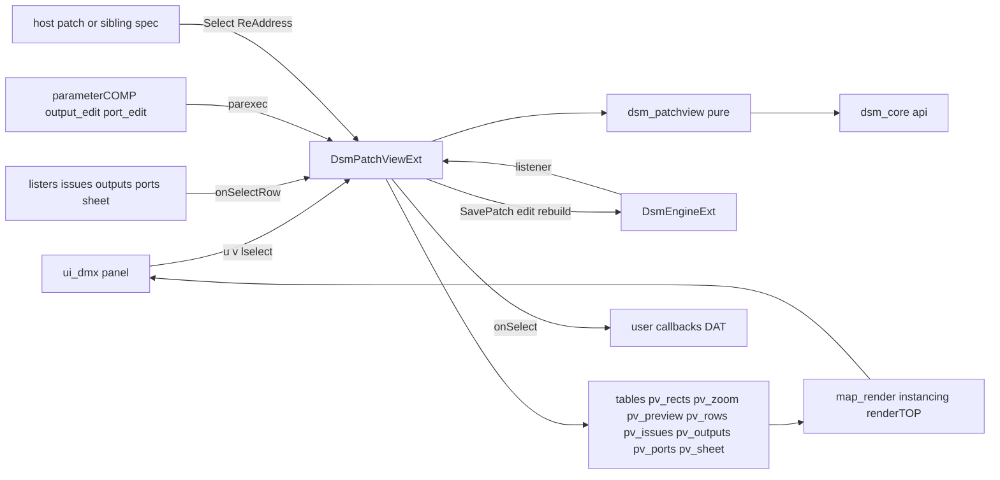
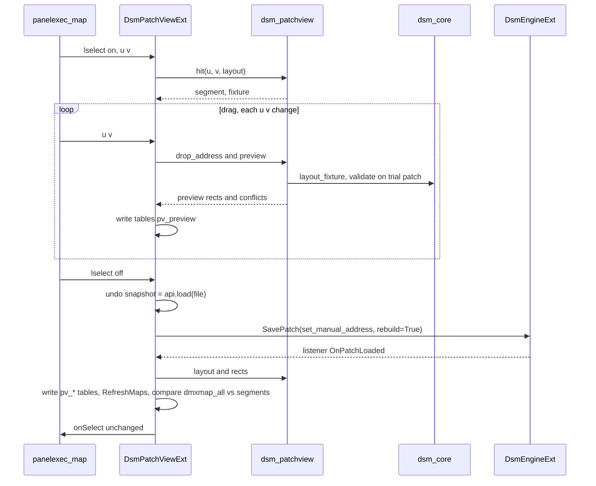
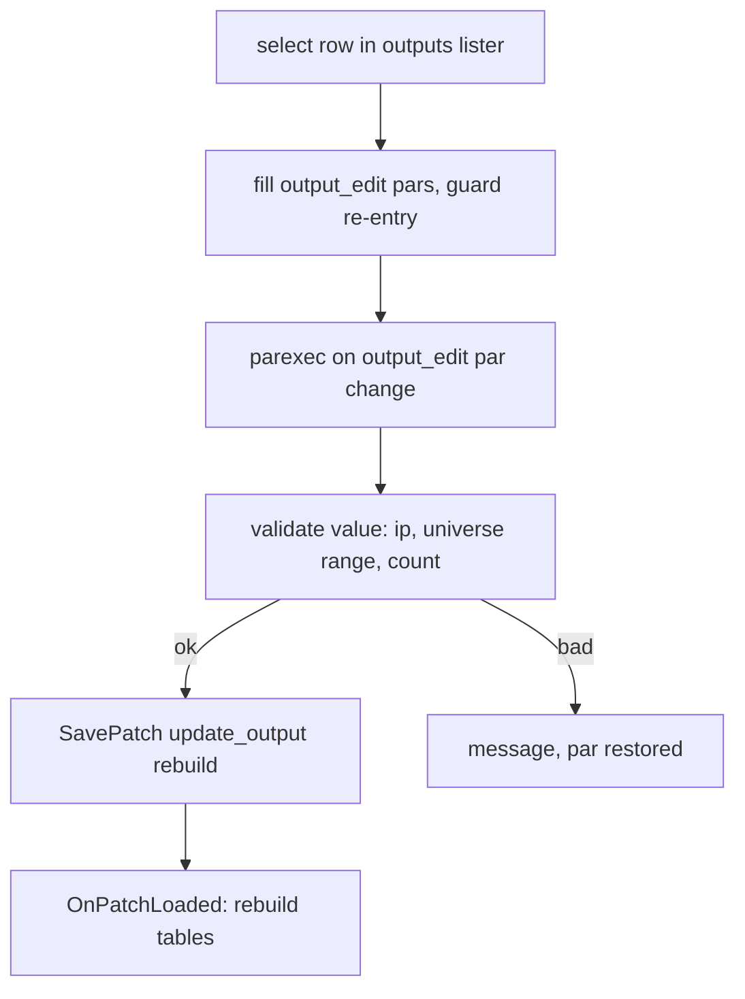

# Design Document — `patch-view`

## Overview

**Purpose**: вкладка DMX внутри компонента `dsm` показывает карту юниверсов по выходам с сегментами фикстур,
конфликты ядра на ней, даёт переадресацию перетаскиванием, правку выходов и портов и лист адресов. Каждая правка
идёт через ядро `dsm_core`, пишется в файл патча записью движка и перестраивает вывод.
**Users**: техник и светохудожник на раздаче адресов; соседние спеки (`locate-test`, `mapping-editor`) — через выбор фикстуры.
**Impact**: компонент `dsm` получает панель `ui_dmx` с окном по паре, третье расширение `DsmPatchViewExt`, чистый
модуль `dsm_patchview`, таблицы карты, колбэк `onSelect`, методы правки. Движок получает только `CallUser` (остальное — `SavePatch`,
`AddListener`, `AddInfoProvider`, `WriteInfo`, `RefreshMaps` — уже в `main` после PR #5). `Version` 0.1 → 0.2 (или 0.3, если
`locate-test` доделан раньше).

### Goals
- Карта: строка на юниверс, сегменты по каналам, крупный юниверс клетками, конфликты красным, предупреждения жёлтым.
- Переадресация: перетаскивание с предпросмотром и привязкой к ячейке, перенос на выход, возврат в авто, подряд для выбора, поля.
- Выходы и порты: полная правка через ядро; «раздать заново».
- Запись: файл патча и вывод совпадают после каждой правки; карта движка сверена с ядром; одна ступень отмены.
- Без Python в кадре; перестройка карты ≤ 1 с на 300 фикстур / 100 юниверсов.

### Non-Goals
- Холст INPUT/OUTPUT, геометрия, профили, Locate, импорт Resolume, многошаговый undo, лист патча HTML/MD.

## Boundary Commitments

### This Spec Owns
- Чистую логику карты: строки прямоугольников карты и крупного юниверса, попадание по `u/v`, адрес по точке с привязкой,
  предпросмотр перетаскивания, цвета фикстур, сводки, строки списков выходов/портов, CSV листа адресов.
- Расширение `DsmPatchViewExt`: состояние панели, таблицы карты, правки через ядро и `SavePatch`, отмена, выбор, `onSelect`, методы.
- Панель `ui_dmx` (контейнер, рендер карты, листеры, редакторы выхода и порта, окно по паре) и её пары на странице `Dmx`.
- Режим `patchview` стенда `tools/engine_check.py`.

### Out of Boundary
- Движок (`DsmEngineExt`, геометрия, вывод, карта `out5`) — только вызывается; единственное добавление — публичный
  `CallUser(name, *args)` (обёртка над вызовом DAT `Callbacks`), чтобы колбэк `onSelect` шёл тем же путём, что `onPatchLoaded`.
- Модель и правила ядра; расширение Locate и его таблицы; геометрия фикстур и профили.

### Allowed Dependencies
- `dsm_core.api`: `segments_by_fixture`, `validate`, `layout_fixture`, `address_table`, `issue_table`, `summary`,
  `set_manual_address`, `assign_to_output`, `clear_address`, `assign_sequential`, `auto_assign`, `add/update/remove_output`,
  `add/update/remove_port`, `load`, `get_*`; `dsm_core.protocol` (`dotted`, `universe_range`).
- `DsmEngineExt`: `patch`, `issues`, `patch_path`, `SavePatch`, `AddListener`, `AddInfoProvider`, `WriteInfo`, `RefreshMaps`,
  `CallUser` (добавляется этой спекой, см. Modified Files).
- Таблицы движка — только чтение (`tables/info`, `diag/dmxmap_all`).
- Узлы TD 2025.33070: `containerCOMP`, `textCOMP`, `panelexecuteDAT`, `parameterCOMP`, `parameterexecuteDAT`, `listCOMP`
  (клон `op.TDTox`), `dattoCHOP`, `geometryCOMP` с инстансингом, `rectangleSOP`/`gridSOP`, `cameraCOMP`, `renderTOP`, `windowCOMP`.
- Направление: `dsm_core` ← `dsm_patchview` (чистый) ← `dsm_patchview_ext` (TD) → `DsmEngineExt`; `dsm_patchview` не импортирует
  `dsm_geometry`, `dsm_locate`; движок и Locate не знают про `patch-view`.

### Revalidation Triggers
- Смена сигнатур `SavePatch` / `AddListener` в движке — перепроверить правки и слушатель.
- Смена `Segment`, `address_table`, `issue_table` или кодов `IssueCode` в ядре — перепроверить строки карты и раскраску.
- Смена контракта `onSelect(fixture_ids)` / `Select` — перепроверить `locate-test`, `mapping-editor`.
- Смена структуры `outputs[]`/`ports[]` в схеме патча — перепроверить редакторы выхода и порта.

## Architecture

### Existing Architecture Analysis
- Таблицы DAT — граница Python/GPU; Python по событию; `parentshortcut dsm`; DAT синхронизированы с файлами `src/`.
- Движок после загрузки зовёт слушателей; `SavePatch(edit, rebuild=True)` перечитывает файл, применяет правку и грузит заново.
- Превью движка: `diag/cam` (ортокамера) + `geometryCOMP` + `renderTOP` — образец для карты.
- В dev-проекте есть Locate (в обходе) — вывод байт в байт как у 0.1.

### Architecture Pattern & Boundary Map



**Architecture Integration**:
- Selected pattern: как у движка и Locate — расширение по событию пишет таблицы, GPU рисует; списки — клоны `listCOMP`
  на таблицах, поля — `parameterCOMP` на служебных парах.
- Domain boundaries: правки — только функции ядра, запись — только `SavePatch`; панель не держит патча.
- New components rationale: чистый модуль — pytest и эталон стенда; отдельное расширение — третье на COMP, движок и Locate не трогаются.
- Steering compliance: патч — источник правды; Python по событию; без абсолютных путей; 1280×720; переносимость `.tox`.

### Technology Stack

| Layer | Choice / Version | Role in Feature | Notes |
|---|---|---|---|
| Чистая логика | Python 3.11 / 3.12, stdlib + `dsm_core` | `dsm_patchview` | без TD |
| Слой TD | TouchDesigner 2025.33070, расширение COMP (`ext2`) | `DsmPatchViewExt` | |
| Карта | `dattoCHOP` → `geometryCOMP` instancing → `renderTOP` (ортокамера) | `ui_dmx/map_render`, `zoom_render` | как `diag/preview_render` |
| UI | `containerCOMP` 1280×720, `textCOMP`, `panelexecuteDAT`, `listCOMP` (TDTox), `parameterCOMP`, `windowCOMP` | `ui_dmx` | мануал twozero `ui_building`, `lister` |

## File Structure Plan

### Directory Structure
```
src/
├── td/
│   ├── dsm_patchview.py          # чистый: MapLayout, rect-строки карты и крупного юниверса, hit, drop_address, preview,
│   │                             #   цвет фикстуры, сводки, строки списков выходов/портов, строки листа и CSV
│   └── dsm_patchview_ext.py      # DsmPatchViewExt: состояние панели, запись таблиц, правки через ядро + SavePatch,
│                                 #   отмена, выбор/onSelect, методы, обработчики панели и листеров
tests/
└── test_td_patchview.py          # pytest dsm_patchview (без TD)
td/stand/
└── patchview_test.json           # синтетический патч: 3 выхода (Art-Net ×2, sACN), порты, ручной и авто адреса,
                                  #   конфликт пересечения, фикстура без адреса, 127.0.0.x
```

### Modified Files
- `tools/engine_check.py` — режим `patchview`: правка методом → JSON-diff файла → перезагрузка → карта движка против
  ядра → перехват байт в байт на новых адресах; файл только для чтения; замер перестройки карты; `td_audit_panel`.
- `src/td/dsm_engine_ext.py` — публичный `CallUser(name, *args)` → `_call` (колбэк пользователя из частей компонента).
- `src/td/dsm_callbacks_default.py` — шаблон `onSelect(fixture_ids)`.
- `docs/engine.md` — страница `Dmx`, методы, колбэк, панель, таблицы `pv_*`; `agents_md`; `CHANGELOG.md`, `README.md`.
- `td/dsm_dev.toe` (через twozero): `dsm` — страница пар `Dmx`, `ext2 = DsmPatchViewExt`, DAT `patchview_mod`, `patchview_ext`;
  `tables/pv_*`; `ui_dmx` (см. ниже); `diag` без изменений; `Version`.

### Панель `ui_dmx` (структура операторов)
```
dsm/ui_dmx                         containerCOMP 1280×720, parentshortcut='dmx', align=verttb, display=False (окно по паре)
├── header_bar                     h=36: output_tabs (выбор выхода/«все»), counters (ошибки/предупреждения), buttons (undo, auto, csv)
├── body_lr                        fill, align=horizlr
│   ├── map_area                   fill: контейнер карты; par.top → map_render/out; panelexec_map (u/v/lselect/rselect)
│   │   ├── map_render             baseCOMP: rects_chop(dattoCHOP ← ../../../tables/pv_rects) → geo_rects(instancing) → cam → render → out
│   │   ├── preview_render         то же для tables/pv_preview (слой поверх, overTOP)
│   │   └── tooltip                textCOMP, alignallow=ignore, layer 10 — имя фикстуры/ячейки под курсором
│   ├── zoom_area                  w=420: крупный юниверс; zoom_render (pv_zoom), panelexec_zoom
│   └── side_tabs                  w=360, align=verttb: tab_bar + один активный из:
│       ├── issues_list            lister на tables/pv_issues
│       ├── outputs_pane           lister на tables/pv_outputs + output_edit (baseCOMP с кастом-парами) + parameterCOMP + parexec
│       ├── ports_pane             lister на tables/pv_ports (цепочка, drag-порядок) + port_edit + parameterCOMP + parexec
│       └── sheet_list             lister на tables/pv_sheet (лист адресов)
├── listerConfig_*                 копии op.TDTox.op('listerConfig') на каждый листер
└── win                            windowCOMP на ui_dmx, открывается парой Dmxwindow
```

## System Flows

### Переадресация перетаскиванием



- Отпускание вне карты — отмена перетаскивания, таблица `pv_preview` пустая.
- Ошибка ядра (`LayoutError`, `OperationError`) → `_fail`: сообщение, патч прежний (4.7).
- После загрузки сравнение адресов «до/после» → «сдвинулось N» (4.8).

### Правка выхода



## Requirements Traceability

| Requirement | Summary | Components | Interfaces | Flows |
|---|---|---|---|---|
| 1.1 | панель 1280×720, окно по паре | `ui_dmx`, `win`, пара `Dmxwindow` | | |
| 1.2 | патч движка — источник | `DsmPatchViewExt` читает `eng.patch` | | |
| 1.3 | перестройка ≤ 1 с, выбор сохраняется | `OnPatchLoaded`, `_rebuild` | слушатель | |
| 1.4 | нет патча / ошибка → статус, без правок | `_rebuild` (пустые таблицы, `pv_status`), блокировка команд | | |
| 1.5 | контракт 0.x, Version | все | | |
| 1.6 | закрытая панель — 0 стоимости | `ui_dmx.display=False`, `allowCooking` рендеров по `Dmxwindow` | | |
| 2.1 | строки юниверсов + подписи | `dsm_patchview.map_layout`, `pv_rows` | | |
| 2.2 | сегменты по каналам, head/tail, 511–512 | `map_rects` (kind, цвет, штриховка) | | |
| 2.3 | подписи сегментов и подсказка | `pv_labels` → `labels_render`/`tooltip`, `hit` | | |
| 2.4 | крупный юниверс | `zoom_rects`, `zoom_area` | | |
| 2.5 | выбор выхода, «все» | `output_tabs`, `SelectOutput` | | |
| 2.6 | цвет фикстуры | `fixture_color(id)` | | |
| 2.7 | сводка выхода | `output_summary` → `pv_outputs` | | |
| 3.1 | красные/жёлтые отметки | `map_rects` слой `issue` по `issue_table` | | |
| 3.2 | список проблем, переход | `issues_list` ← `pv_issues`, `ShowIssue` | `onSelectRow` | |
| 3.3 | не размещены | `pv_unassigned` → листер «не размещены» в `side_tabs`; выбор строки + клик по карте (drag из листера — если есть колбэк drop) | | |
| 3.4 | счётчики | `counters` ← `pv_status` | | |
| 4.1 | перетаскивание, шаг ячейки, Shift | `hit`, `drop_address(snap)`, `ReAddress` | `panelexec_map` | Переадресация |
| 4.2 | на другой выход | `drop_address` (строка другого выхода) → `assign_to_output`/`set_manual_address` | | Переадресация |
| 4.3 | предпросмотр | `preview`, `pv_preview`, `preview_render` | | Переадресация |
| 4.4 | в авто | `ToAuto` → `clear_address` + `assign_to_output` | | |
| 4.5 | подряд для выбора | `Sequential(ids, universe, channel)` → `assign_sequential` | | |
| 4.6 | поля юниверса/канала | `fixture_edit` пары `Universe`, `Channel` + parexec | | |
| 4.7 | ошибки ядра не ломают патч | `_edit` (`try` ядро → `SavePatch`), `_fail` | | |
| 4.8 | «сдвинулось N» | `_edit` сравнение адресов до/после загрузки | | |
| 4.9 | отмена | `Undo` ← `_undo_doc` | | |
| 5.1 | параметры выхода | `output_edit` + `parameterCOMP` + parexec → `update_output` | | Правка выхода |
| 5.2 | добавить/удалить выход | `AddOutput`, `RemoveOutput` | | |
| 5.3 | порты и цепочка | `ports_pane`, `port_edit`, `ReorderPort` → `update_port` | | |
| 5.4 | раздать заново | `AutoAssign(output_id)` → `auto_assign` | | |
| 5.5 | лимиты/дубли как конфликты | `issue_table` → `map_rects` | | |
| 6.1 | запись + пересборка ≤ 2 с | `_edit` → `SavePatch(rebuild=True)` | | |
| 6.2 | меняется только затронутое | функции ядра чистые, `SavePatch` перечитывает файл | | |
| 6.3 | ошибка записи | `SavePatch` False → `_fail`, карта прежняя | | |
| 6.4 | сверка с картой движка | `_verify_engine_map` (`RefreshMaps`, `dmxmap_all` vs `segment_table`) | | |
| 6.5 | Python по событиям | panelexec/parexec/listener; рендер — GPU | | |
| 7.1 | CSV листа | `ExportSheet` → `sheet_csv` | | |
| 7.2 | лист в панели | `sheet_list` ← `pv_sheet` | | |
| 8.1 | `onSelect` один раз | `_select` → `CallUser("onSelect", ids)` | колбэк | |
| 8.2 | `Select` снаружи | `Select(ids)` → подсветка в `pv_rects` | | |
| 8.3 | методы | `Open/Close`, `SelectOutput`, `ReAddress`, `ToAuto`, `Sequential`, `AutoAssign`, `ExportSheet`, `Undo` | | |
| 9.1 | ≤ 1 с | одна запись таблиц; замер в стенде | | |
| 9.2 | предпросмотр ≥ 20 Гц | расчёт только фикстуры, таблица `pv_preview` малая | | |
| 9.3 | читаемость | `Geom`-пары `Rowheight ≥ 16`, клетки ≥ 20 px | | |
| 10.1 | pytest | `tests/test_td_patchview.py` | | |
| 10.2 | стенд | режим `patchview` | | |
| 10.3 | audit, цена при закрытой | `td_audit_panel`, `perf` с закрытой панелью | | |
| 10.4 | docs | `docs/engine.md`, режим `docs` | | |

## Components and Interfaces

| Component | Domain/Layer | Intent | Req Coverage | Key Dependencies | Contracts |
|---|---|---|---|---|---|
| `dsm_patchview` | чистая логика | раскладка карты, попадание, адрес по точке, предпросмотр, списки, CSV | 2.x, 3.1, 3.3, 4.1–4.3, 7.1, 9.x, 10.1 | `dsm_core.api` (P0) | Service |
| `DsmPatchViewExt` | слой TD | состояние, таблицы, правки, отмена, выбор, методы | 1.x, 3.2, 3.4, 4.x, 5.x, 6.x, 7.x, 8.x | `dsm_patchview`, `DsmEngineExt` (P0) | Service, State |
| `ui_dmx` | UI | панель, рендер карты, листеры, редакторы, окно | 1.1, 1.6, 2.x, 3.2, 5.1, 5.3, 7.2, 9.3 | `DsmPatchViewExt` (P0), TDTox lister (P1) | — |
| режим `patchview` стенда | проверка | факты 10.2–10.3 | 10.2, 10.3 | `dsm_patchview`, `tools/dmx_listen.py` | Batch |

### Чистая логика

#### `dsm_patchview`

| Field | Detail |
|---|---|
| Intent | всё, что карта решает без TD: где и какого цвета прямоугольник, куда попал курсор, какой адрес выйдет из точки |
| Requirements | 2.1–2.7, 3.1, 3.3, 4.1–4.3, 4.5, 7.1, 9.1–9.3, 10.1 |

**Contracts**: Service [x]

##### Service Interface
```python
@dataclass(frozen=True)
class RowInfo:            # строка карты
    output_id: str; universe: int; dotted: str; index: int      # index — порядок строки сверху
    declared: bool        # в заявленном диапазоне выхода
    used_channels: int

@dataclass(frozen=True)
class MapLayout:
    rows: tuple[RowInfo, ...]
    segments: tuple[SegInfo, ...]       # SegInfo(fixture_id, row, first_channel, last_channel, kind, cells, color, issue_level)
    skip_511_512: dict[str, bool]       # по выходу

def map_layout(patch, segments, issues, output_id: str | None) -> MapLayout: ...   # None — все выходы, группами
def map_rects(layout, selected: set[str], geom: Geom) -> list[list[str]]: ...     # строки pv_rects: x y w h r g b a layer
def zoom_rects(layout, row: int, geom: Geom) -> list[list[str]]: ...               # 512 клеток + сегменты
def label_rows(layout, geom: Geom) -> list[list[str]]: ...                         # подписи сегментов и юниверсов (pv_labels)
def fixture_color(fixture_id: str) -> tuple[float, float, float]: ...              # стабильный хэш
def hit(layout, u: float, v: float) -> Hit: ...                                     # Hit(row|None, channel|None, segment|None)
def drop_address(layout, patch, fixture_id, row: int, channel: int, snap: bool) -> tuple[str, int, int]: ...   # (output_id, universe, channel)
def preview(patch, fixture_id, output_id, universe, channel) -> Preview: ...       # Preview(segments, issues, error|None) по пробному патчу
def shifted(before: Patch, after: Patch) -> list[str]: ...                          # фикстуры, у которых изменился адрес
def output_rows(patch, segments, issues) -> list[list[str]]: ...                   # pv_outputs: id name protocol target ip start count used fixtures cells errors
def port_rows(patch, output_id) -> list[list[str]]: ...                            # pv_ports: port number new_universe max_cells max_universes chain
def issue_rows(issues) -> list[list[str]]: ...                                      # pv_issues (issue_table + подсказка перехода)
def sheet_rows(patch) / sheet_csv(rows) -> ...                                      # address_table ядра, CSV `;`
```
- Preconditions: `segments = segments_by_fixture(patch)`, `issues = validate(patch)` после `auto_assign_all` (как в движке).
- Invariants: порядок строк карты — выходы в порядке патча, юниверсы по возрастанию; `hit` и `map_rects` считают по одной
  раскладке (`Geom`: высота строки, поля, ширина канала = 1/512), поэтому клик попадает ровно в нарисованное.
- `drop_address` при `snap=True` округляет канал к `1 + k·(каналов на ячейку профиля)`; `channel` вне 1–512 → край.

### Слой TouchDesigner

#### `DsmPatchViewExt`

| Field | Detail |
|---|---|
| Intent | состояние панели, таблицы карты, правки через ядро и движок, отмена, выбор, события |
| Requirements | 1.2–1.4, 3.2, 3.4, 4.x, 5.x, 6.x, 7.1, 8.x |

**Responsibilities & Constraints**
- Состояние — атрибуты экземпляра: `output_id | None`, `zoom_row | None`, `selection: tuple[str, ...]`, `drag: Drag | None`,
  `undo_doc: Patch | None`, `message`; патча своего нет (1.2).
- Каждая правка — `_edit(edit_fn, label)`: `undo_doc = api.load(file)` → `SavePatch(edit_fn, rebuild=True)` → по слушателю
  `_rebuild()` → `_verify_engine_map()` → сообщение «сдвинулось N»; ошибка — `_fail(message)`.
- Пары страницы `Dmx` отражают состояние; запись из метода не вызывает метод повторно (флаг, как в Locate).

**Contracts**: Service [x] / State [x]

##### Service Interface
```python
class DsmPatchViewExt:
    def Open(self) -> None / Close(self) -> None                     # окно
    def SelectOutput(self, output_id: str | None) -> None            # None — все
    def ShowIssue(self, index: int) -> None
    def Select(self, fixture_ids: list[str]) -> None                 # подсветка, без onSelect
    def Selection(self) -> list[str]
    def ReAddress(self, fixture_id: str, output_id: str, universe: int, channel: int) -> bool
    def ToAuto(self, fixture_id: str, output_id: str | None = None) -> bool
    def Sequential(self, fixture_ids: list[str], universe: int, channel: int) -> bool
    def AutoAssign(self, output_id: str) -> bool
    def AddOutput(self) -> str | None / RemoveOutput(self, output_id: str) -> bool
    def UpdateOutput(self, output_id: str, **fields) -> bool
    def AddPort(self, output_id: str) -> str | None / RemovePort(self, output_id: str, port_id: str) -> bool
    def UpdatePort(self, output_id: str, port_id: str, **fields) -> bool
    def ReorderPort(self, output_id: str, port_id: str, fixture_ids: list[str]) -> bool
    def Undo(self) -> bool
    def ExportSheet(self, path: str | None = None) -> str
    def OnPatchLoaded(self, patch, issues) -> None                   # слушатель движка
    def OnMap(self, event: str, u: float, v: float, shift: bool) -> None   # из panelexec_map: down / move / up / hover
    def OnDmxPar(self, par) -> None                                  # parexec страницы Dmx и редакторов
```
- Postconditions: успешная правка → файл изменён только в затронутых полях, движок перезагружен, карта и списки
  перестроены, `undo_doc` заполнен; отказ → патч, файл и карта прежние, `message`, `onOutputError`.

##### State Management
- Таблицы: `tables/pv_rects`, `pv_preview`, `pv_zoom`, `pv_labels`, `pv_rows`, `pv_issues`, `pv_unassigned`, `pv_outputs`, `pv_ports`,
  `pv_sheet`, `pv_status` (key/value: output, errors, warnings, message, selection) — пишутся одной операцией каждая.
- Служебные COMP с кастом-парами: `ui_dmx/output_edit` (имя, протокол, цель, IP, стартовый юниверс, диапазон, правила,
  частота, ArtSync, priority, задержка), `ui_dmx/port_edit`, `ui_dmx/fixture_edit` (юниверс, канал выбранной фикстуры).

**Implementation Notes**
- Integration: `AddListener(OnPatchLoaded)` и `AddInfoProvider` (строки `dmx_*` в `info`) при инициализации; `onSelect` через
  колбэки пользователя один раз на смену выбора.
- Validation: стенд `patchview`, `td_audit_panel`, `td_get_errors`.
- Risks: двойная загрузка при смене `Patchfile` (известно) — слушатель перестраивает идемпотентно.

#### `ui_dmx` (UI)
- По мануалу twozero: обёртка `ui_dmx` с `parentshortcut='dmx'`, кастом-пары страниц Style/Geom (цвета, высота строки,
  поля) на корне панели, авто-раскладка (`verttb` корень, `horizlr` тело), `viewer=True`, `resizecomp/repocomp`
  константами, `resetNodeSize`, шрифты — TD-поставляемые (`PT Mono`/`Open Sans`).
- Карта: `map_area.par.top = map_render/out`; `panelexec_map` на `lselect`/`u`/`v`/`inside` → `OnMap`; подсказка `tooltip`
  (`alignallow=ignore`, `layer 10`) по `hit`. Подписи сегментов — `labels_render` (`geotextCOMP`-инстансы или `textTOP`) для
  сегментов шире порога `Geom.Labelmin` (px); юниверсы подписаны слева всегда; выбор техники — по читаемости в задаче 3.2 (2.3).
- Не размещённые фикстуры (3.3): таблица `pv_unassigned` → список в `side_tabs`; размещение — выбор строки + клик по карте
  (адрес по точке общим путём); перетаскивание из листера на карту — только если `listCOMP` даёт колбэк drop (мануал `lister`).
- «Подряд» для нескольких фикстур (4.5): множественный выбор в листе адресов + кнопка; без множественного выбора — методом.
- Листеры: четыре клона `op.TDTox.op('lister')` с копиями `listerConfig`, источники — таблицы `pv_*`, цвет строк проблем —
  `SetCellOverlay`, выбор → `onSelectRow` → методы расширения через `parent.dmx`; `Inputtabledat` — имя соседа.
- Редакторы: `parameterCOMP` на `output_edit`/`port_edit`/`fixture_edit`; `parexec_edit` → `OnDmxPar` → правка ядра.
- Окно: `win` (`windowCOMP`, `winop = ui_dmx`), пара `Dmxwindow`; `ui_dmx.display=False`; при закрытом окне `allowCooking=False`
  на `map_render`/`zoom_render`/`preview_render` (1.6).

## Data Models

### Пары страницы `Dmx`
| Пара | Тип | По умолчанию | Смысл |
|---|---|---|---|
| `Dmxwindow` | Toggle | выкл. | окно панели DMX |
| `Dmxoutput` | Str | пусто | выбранный выход (`id`); пусто — все |
| `Dmxsnap` | Toggle | вкл. | привязка к ячейке при перетаскивании |
| `Dmxundo` | Pulse | | отменить последнюю правку |
| `Dmxexport` | Pulse | | экспорт листа адресов CSV |

### Таблица `pv_rects` / `pv_preview` / `pv_zoom`
`x y w h r g b a layer kind id` — координаты в долях области (0–1), `layer`: 0 подложка юниверса, 1 сегмент, 2 обводка
конфликта/предупреждения, 3 выделение; `kind`: `bg | cells | head | tail | skip | issue | select | cell`; `id` — фикстура.

### `pv_status` (`info` строки `dmx_*`)
`dmx_output`, `dmx_errors`, `dmx_warnings`, `dmx_selection`, `dmx_message`, `dmx_last_edit`.

## Error Handling

### Error Strategy
- Отказ ядра (`OperationError`, `LayoutError`, `ValueError` диапазонов) — команда отклонена целиком, патч и карта прежние,
  причина в `dmx_message` и `onOutputError`.
- Ошибка записи — `SavePatch` вернул False: файл и движок прежние, сообщение; `undo_doc` не меняется.
- Расхождение карты движка с ядром (6.4) — сообщение «вывод не совпадает с патчем» красным в заголовке.
- Нет патча / ошибка загрузки — панель показывает статус движка, команды правки неактивны.

### Monitoring
- Строки `dmx_*` в `info` через `AddInfoProvider`; textport — только исключения обработчиков.

## Testing Strategy

- **Unit (`tests/test_td_patchview.py`)**: `map_layout` на примерах и синтетическом патче (строки, заявленный диапазон,
  511–512, head/tail); `map_rects`/`hit` взаимно обратны на сетке точек; `drop_address` с привязкой и без, края, другой выход;
  `preview` — сегменты и конфликт при наложении, ошибка `LayoutError`; `shifted`; `fixture_color` стабилен и различим;
  `output_rows`/`port_rows`/`issue_rows`; `sheet_csv` туда-обратно.
- **Стенд `patchview` (`td/stand/patchview_test.json`)**: `ReAddress` методом → JSON-diff файла только в адресе → перезагрузка →
  `dmxmap_all` = `segment_table` → перехват байт в байт на новых адресах; `ToAuto`, `Sequential`, `AutoAssign`, `UpdateOutput`,
  порты; `Undo` возвращает файл байт в байт; файл только для чтения → прежний файл и сообщение; время перестройки карты
  на `perf`-патче 20 016 ячеек (100 юниверсов) ≤ 1 с; `perf` с закрытой панелью — прирост 0.
- **UI**: `td_audit_panel(ui_dmx)` без замечаний; клики по карте и спискам дают тот же результат, что методы;
  `.tox` компонента загружается в другом месте без ошибок (приёмка листера).
- **Docs**: режим `docs` — пары `Dmx`, методы, операторы `ui_dmx` верхнего уровня.

## Performance & Scalability
- Таблица карты — строки на сегмент и юниверс (сотни–тысячи), запись одной операцией; рендер — инстансинг, кадр GPU.
- Предпросмотр — только фикстура под курсором: `layout_fixture` + `validate` на пробном патче (миллисекунды).
- Закрытая панель — рендеры в `allowCooking=False`, стоимость 0.

## Runtime Prerequisites
- Слияние PR fmusikhin/diod-sticks-mapper#5 (`locate-test` 1.1–3.3) в `main` и подтягивание `main` в `spec/patch-view`
  до первой задачи реализации: нужны `SavePatch`, `AddListener`, `AddInfoProvider`, `WriteInfo`.
- Мануал twozero `lister` и `td_get_docs('lister')` — перед первым листером; `ui_building` — перед панелью.
