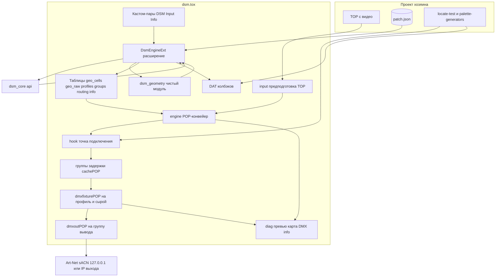
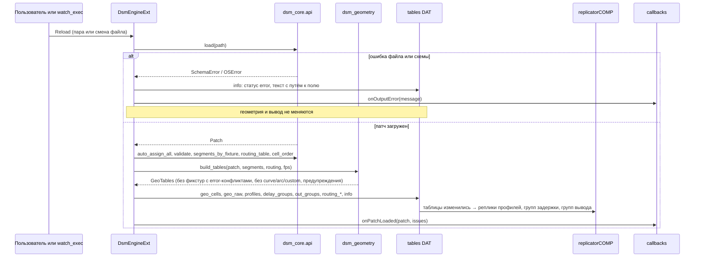
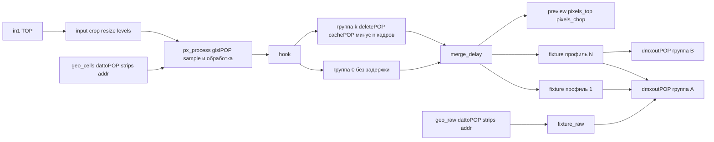

# Design Document — `pixel-engine`

## Overview

**Purpose**: `pixel-engine` — движок Diod Sticks Mapper внутри TouchDesigner: компонент `dsm.tox`,
который по патчу (через ядро `dsm_core`) один раз строит POP-геометрию, а затем каждый кадр без Python
берёт цвет из входного TOP, обрабатывает его на GPU и шлёт Art-Net / sACN на любое число контроллеров
байт в байт по таблицам ядра, синхронно с видео.

**Users**: VJ и светохудожник — бросают `dsm.tox` в свой патч, подключают TOP и файл патча; техник —
сверяет карту DMX и перехват; следующие спеки (`locate-test`, `palette-generators`, `patch-view`) —
подключаются к движку через точку подключения и колбэки.

**Impact**: появляется слой TD: `src/td` (расширение и чистый модуль геометрии), `src/glsl` (шейдер
обработки), компонент `/project1/dsm` и стенд `/project1/stand` в `td/dsm_dev.toe`, `tools/engine_check.py`,
`docs/engine.md`. Ядро `src/core` не меняется (только читается). Стенд этапа 0 `/project1/stage0` остаётся.

### Goals
- Один примитив на сегмент ядра, адрес uint32 на примитиве; Python только при загрузке патча (3.x, 8.3).
- Перехват на 127.0.0.x совпадает с `segment_table` / `cell_table` ядра байт в байт для всех `examples/` (6.10, 10.1).
- ≤ 3 мс на кадр при 20 000 ячеек, 60 fps (исходно ≤ 1 мс, пересмотрено 18.10.2026); ≤ 3,5 мс при 50 000 (8.1, 8.2).
- Контракт компонента по `CONTRIBUTING.md` §4: пары, коннекторы, колбэки, `Id`/`Version`, без абсолютных путей (1.x).
- Число узлов вывода не зависит от числа контроллеров и фикстур (6.1, 6.5).

### Non-Goals
- Интерфейс, редактирование патча, undo — `patch-view`, `mapping-editor`; движок патч только читает (2.6).
- Режимы Locate, тест-паттерны — `locate-test`; Палитра и генераторы — `palette-generators`; темп — `beat-sync`.
- Гамма, баланс белого, RGB→RGBW, лимит мощности — `color-power` (значения из патча читаются, не применяются).
- Формы `curve`, `arc`, `custom`; выборка `area` / `elongated` — этап 2 (3.8, 4.4).
- Делитель частоты; пары компонента, переопределяющие `rate_hz`, `art_sync`, `delay_ms` (7.2, 7.3).
- 3D, несколько входов TOP, NDI.

## Boundary Commitments

### This Spec Owns
- Компонент `dsm` и его публичный контракт: страницы пар `DSM`, `Input`, `Info`; коннекторы
  (вход TOP; выходы превью TOP, пиксели TOP, пиксели CHOP, DAT info, DAT карты DMX); DAT колбэков
  с `onPatchLoaded(patch, issues)` и `onOutputError(message)`; DAT `agents_md`.
- Загрузка патча через `dsm_core.api` и жизненный цикл: статус, ошибки, автоперезагрузка.
- Расчёт геометрии ячеек на холсте: UV по длине дуги для `line`/`polyline`/`rect`, сетка матрицы,
  матрица на линии как лента, перевод `m → px`, признак активности (`disabled`, `every_n`).
- Табличное представление геометрии (`geo_cells` + `geo_prims`, `geo_raw` + `raw_prims`) и статическая POP-цепочка:
  `dattoPOP (точки + примитивы) → glslPOP → hook → группы задержки → dmxfixturePOP на профиль → dmxoutPOP на группу вывода`
  (спайк 1.1: примитивы с uint-адресами строятся из таблицы примитивов; `linebreakPOP` + `attributeconvertPOP` — запасной путь, тоже проверен).
- Шейдер обработки `px_process.glsl`: выборка точкой, `Master`, `brightness`, `color`, `mute`, активность.
- Профили `dmxfixturePOP` из `fixture_type`: порядок цвета, 8/16 бит, `cell_extra`, «сырой» профиль head/tail.
- Группы вывода и маршрутизация: таблицы для `dmxoutPOP`, 127.0.0.1 по умолчанию, broadcast, multicast, priority.
- Синхронизация: частота узла, ArtSync, задержка в кадрах через `cachePOP`, повтор последнего кадра.
- Диагностика: превью, карта DMX, таблица info, счётчики; стенд и скрипт проверки; документация `docs/engine.md`.

### Out of Boundary
- Адресация, сегменты, конфликты, таблицы — только ядро `dsm_core`; движок ничего не пересчитывает и не правит.
- Любая правка JSON патча, undo/redo, выделение, холст.
- Содержимое `hook` (подмена цвета Locate, поля палитры) — следующие спеки; движок гарантирует лишь
  контракт входа/выхода `hook`.
- Цветовые преобразования (`gamma`, `white_balance`, `white_mode`, `watts_per_cell`).
- Поддержка конкретных контроллеров, пресеты «под железо».
- Сетевой приём (Art-Net poll, sACN discovery), Art-Net input.

### Allowed Dependencies
- `dsm_core.api` (чистый Python 3.11, stdlib) — читается как пакет из `src/core` относительным путём от компонента
  (`project.folder` → корень репозитория) или из `sys.path` проекта-хозяина; других внешних пакетов нет.
- TouchDesigner 2025.33070: операторы POP (`dattoPOP`, `linebreakPOP`, `attributeconvertPOP`, `glslPOP`,
  `deletePOP`, `cachePOP`, `mergePOP`, `nullPOP`, `inPOP`, `outPOP`, `dmxfixturePOP`, `dmxoutPOP`, `poptoTOP`,
  `poptoCHOP`), TOP (`inTOP`, `cropTOP`, `resolutionTOP`, `levelTOP`, `nullTOP`, `renderTOP`, `outTOP`),
  DAT (`tableDAT`, `textDAT`, `dmxmapDAT`, `mergeDAT`, `folderDAT`, `datexecuteDAT`, `outDAT`), `replicatorCOMP`,
  `geometryCOMP`/`cameraCOMP` для превью, `timerCHOP`; `numpy` из поставки TD — допустим в расширении.
- Направление зависимостей (слева направо, обратно — никогда):
  `dsm_core → dsm_geometry (чистый) → dsm_engine_ext (TD) → операторы компонента`.
  `dsm_geometry` не импортирует `td`; `dsm_core` не импортирует ничего из `src/td`.
- Файлы — относительные пути: `Patchfile` как задан пользователем, относительный — от `project.folder`.

### Revalidation Triggers
- Изменение `Segment`, колонок `segment_table`/`cell_table`/`routing_table`, `cell_order` в ядре → пересобрать таблицы и стенд.
- Переименование пар, коннекторов или сигнатур колбэков → `MAJOR` версии, `CHANGELOG.md`, все спеки-потребители.
- Изменение контракта `hook` (имена атрибутов `Color`, `fx`, `cell`, `active`) → `locate-test`, `palette-generators`.
- Смена сборки TD → повторить спайк uint и замер стоимости кадра.
- Новые поля `fixture_type` (режимы белого, гамма) → `color-power` правит `px_process.glsl`, не геометрию.

## Architecture

### Existing Architecture Analysis
- Ядро — функциональное, `api` единственная точка входа (`load`, `auto_assign_all`, `validate`,
  `segments_by_fixture`, `routing_table`, `cell_order`, `segment_table`, `cell_table`).
- Стенд этапа 0 закрепил контракт адреса: примитив, uint32, канал с 1, `dmxoutPOP` с таблицей маршрутизации
  (`net subnet universe netaddress priority kinetport`), `rate = me.time.rate`.
- Правила проекта: без абсолютных путей и глобальных шорткатов, `parentshortcut`, механика — пара, политика — колбэк,
  `.tox` — пустая заготовка, текст — источник правды (расширение и шейдер синхронизируются с файлами `src/`).

### Architecture Pattern & Boundary Map



**Architecture Integration**:
- Паттерн: **таблицы как граница между Python и GPU**. Python (расширение) запускается только по событию
  (загрузка, перезагрузка, смена файла) и пишет DAT-таблицы; POP-цепочка статична, читает таблицы и TOP каждый кадр.
- Границы: `dsm_geometry` считает позиции и строки таблиц без TD (тестируется pytest); расширение знает TD,
  но не считает геометрию; шейдер знает только атрибуты точек и униформы.
- Сохранённые паттерны: контракт адреса этапа 0; `dmxoutPOP` с таблицей маршрутизации; `perf_probe` для замера.
- Новые компоненты: `hook` — явный шов для следующих спек; группы задержки и группы вывода — потому что
  `cachePOP`, `rate`, `sendartsync`, `multicast` живут на узле, а патч задаёт их на выход.
- Steering: без Python в кадре, без абсолютных путей, контроллер — данные, вывод на 127.0.0.1 по умолчанию,
  текст — источник правды.

### Technology Stack

| Layer | Choice / Version | Role in Feature | Notes |
|---|---|---|---|
| Компонент | TouchDesigner 2025.33070, `baseCOMP dsm` | корень `.tox`, пары, коннекторы | Non-Commercial достаточно: `resolutionTOP` ≤ 1280 |
| Геометрия и вывод | POP: `dattoPOP`, `linebreakPOP`, `attributeconvertPOP`, `glslPOP`, `deletePOP`, `cachePOP`, `mergePOP`, `dmxfixturePOP`, `dmxoutPOP` | конвейер кадра без Python | факты — `research.md` |
| Шейдер | GLSL 4.30 compute (`glslPOP`) | выборка + обработка | `src/glsl/px_process.glsl` ↔ DAT |
| Расширение | Python 3.11 (встроенный TD), `numpy` допустим | загрузка патча, таблицы, колбэки, статус | `src/td/dsm_engine_ext.py` ↔ DAT |
| Чистый модуль | Python 3.11 stdlib | UV по длине дуги, сетка матрицы, строки таблиц | `src/td/dsm_geometry.py`, pytest |
| Ядро | `dsm_core.api` | адреса, сегменты, маршрутизация, проверки | не меняется |
| Проверка | `tools/engine_check.py` (в TD), `tools/dmx_listen.py`, pytest | байт в байт, карта DMX, стоимость кадра | отчёты в `td/stand/reports/` (gitignore) |

## File Structure Plan

### Directory Structure
```
src/td/
├── dsm_geometry.py          # чистый: cell_positions(shape, n, direction, offset) → список (x, y) по длине дуги;
│                            #   rect_grid(shape, w, h) → клетки; m→px; build_tables(patch, segments, routing, fps)
│                            #   → GeoTables(cells_rows, raw_rows, profiles_rows, delay_groups, out_groups, routing_by_group,
│                            #   warnings). Без импорта td.
├── dsm_engine_ext.py        # DsmEngineExt(ownerComp): Reload(), LoadPatch(path), Status, Issues; пишет DAT, зовёт колбэки,
│                            #   управляет репликаторами, таймером счётчиков. Единственное место с td-API.
└── dsm_callbacks_default.py # шаблон DAT колбэков: onPatchLoaded(patch, issues), onOutputError(message) — пустые тела
src/glsl/
└── px_process.glsl          # compute: Color = sample(Tex) · uMaster · bright · col · (1-mute) · active
tools/
└── engine_check.py          # запускается внутри TD: для examples/*.json — Reload, dmxmapDAT vs segment_table,
                             #   dmx_listen на 127.0.0.x vs cell_table (байт в байт), замер кадра (realTime=False,
                             #   totalCooks), отчёт JSON + «совпало / расхождения»
tests/
└── test_td_geometry.py      # pytest для dsm_geometry: UV по длине дуги, polyline, rect с поворотом, матрица 16 раскладок,
                             #   матрица на линии как лента, m→px, disabled/every_n, строки таблиц для sticks_8x_artnet
td/
├── dsm_dev.toe              # /project1/dsm — компонент; /project1/stand — стенд проверки (контрольная точка в git)
└── stand/reports/           # JSON-отчёты engine_check (в .gitignore)
docs/
└── engine.md                # контракт компонента: пары, коннекторы, колбэки, hook, таблицы, стенд, стоимость кадра
```

Структура компонента `/project1/dsm` (имена операторов — контракт для задач и `agents_md`):
```
dsm (baseCOMP, parentshortcut='dsm', ext0object=op('./engine_ext').module.DsmEngineExt(me))
├── agents_md, engine_ext (DAT ↔ src/td/dsm_engine_ext.py), geometry_mod (DAT ↔ src/td/dsm_geometry.py),
│   callbacks (DAT, par Callbacks), px_process_glsl (DAT ↔ src/glsl/px_process.glsl)
├── in1 (inTOP)                                   # единственный вход
├── input/        crop → resize → levels → in_prepared (nullTOP)
├── tables/       geo_cells, geo_prims, geo_raw, raw_prims, fx_arrows, profiles, delay_groups, out_groups, fixture_sets, raw_sets,
│                 routing_<grp>, info (tableDAT)
├── engine/       pts_cells (dattoPOP: geo_cells + geo_prims → line strip с uint-адресами на примитиве)
│                 → px_process (glslPOP, sampler=in_prepared) → px_out (nullPOP)
│                 pts_raw (dattoPOP: geo_raw + raw_prims) → raw_out (nullPOP)
├── hook/         in1 (inPOP) → out1 (outPOP)     # точка подключения
├── delay/        rep (replicatorCOMP по delay_groups, master ../templates/delay_tpl) → grp<k>/{sel, keep (deletePOP dgrp==k), cache (cachePOP)}
│                 → merge_delay (mergePOP) → px_final (nullPOP)
├── fixtures/     rep (replicatorCOMP по fixture_sets = профиль × группа вывода, master ../templates/fx_tpl) → p<k>g<j>/{sel,
│                 keep (deletePOP prof==k и ogrp==j), attrs, fixture (dmxfixturePOP), map (dmxmapDAT)};
│                 rep_raw (по raw_sets — группы с head/tail, master ../templates/raw_tpl) → raw_g<j>/{sel, keep ogrp==j, fixture, map}
├── output/       rep (replicatorCOMP по out_groups, master ../templates/out_tpl) → out_g<j>/out (dmxoutPOP: interface, multicast,
│                 rate, sendartsync, routingtable=../../tables/routing_g<j>, fixture<i>pop → ../fixtures/p<k>g<j> и raw_g<j>; active — константа от ApplyActive)
├── diag/         preview (renderTOP: geo_pts + geo_arrows, ортокамера по canvas из info; overTOP над in_prepared), pixels_top (poptoTOP),
│                 pixels_chop (poptoCHOP, active ← Pixelschop) → pixels_named (renameCHOP r g b a), rep_maps (replicatorCOMP по map_sets:
│                 selectDAT map_<set> → ../fixtures/<set>/map) → dmxmap_all (mergeDAT), counters (timerCHOP 1 Гц → UpdateCounters)
├── watch/        watch_folder (folderDAT), watch_exec (datexecuteDAT → Reload)
├── templates/    fx_tpl, delay_tpl — мастера репликаторов; allowCooking=False на COMP (шаблон не кукает и не дублирует каналы)
└── out1 (outTOP превью), out2 (outTOP пиксели), out3 (outCHOP пиксели), out4 (outDAT info), out5 (outDAT карта DMX)
```

### Modified Files
- `README.md` — таблица спек (`pixel-engine` реализовано), раздел «Структура» (`src/td`, `src/glsl`, `tools/engine_check.py`).
- `docs/architecture.md` — §4 и §6 по факту реализации, §13 таблица стоимости на 20 000 / 50 000, §14 новые грабли.
- `CHANGELOG.md` — запись спеки; `.gitignore` — `td/stand/reports/`.
- `.kiro/steering/structure.md` — примеры путей `src/td/dsm_engine_ext.py`, `src/glsl/px_process.glsl`.

## System Flows

### Загрузка патча

Решения: запись таблиц — последним шагом, после успешного расчёта (атомарность 2.3); фикстуры с ошибками
ядра и без адреса не попадают в строки (2.4, 2.5); `Active=False` или патч не загружен → `out.active=False` у всех узлов (2.8, 6.6).

### Кадр

Решения: всё в одном куке хозяина (7.1); `dmxoutPOP` кукается сам при `viewer=False` (6.7, этап 0);
если вход не кукнулся — атрибуты не меняются и уходят прежние значения (7.6); `realTime=False` —
пакеты на каждый кук (7.7).

## Requirements Traceability

| Requirement | Summary | Components | Interfaces | Flows |
|---|---|---|---|---|
| 1.1 | один компонент, вход TOP, контракт парами | `dsm`, `in1` | пары, коннекторы | — |
| 1.2 | `Id`, `Version` readOnly, `0.1` | страница `Info` | `par.Id`, `par.Version` | — |
| 1.3 | пары DSM и Input; частота/ArtSync/задержка — из патча | страницы `DSM`, `Input` | таблица пар ниже | — |
| 1.4 | выходы превью, пиксели TOP/CHOP, info, карта DMX | `diag`, `out1..out5` | коннекторы | кадр |
| 1.5 | DAT колбэков `onPatchLoaded`, `onOutputError` | `callbacks`, `DsmEngineExt` | контракт колбэков | загрузка |
| 1.6 | без абсолютных путей и шорткатов; относительный `Patchfile` | все операторы, `DsmEngineExt.resolve_path` | `parentshortcut='dsm'` | — |
| 1.7 | несколько копий независимо | `dsm` (всё внутри, нет глобальных имён) | — | — |
| 1.8 | пустая заготовка, `agents_md`, `Version 0.1` | экспорт `.tox`, `agents_md` | — | — |
| 1.9 | TD 2025.33070 Non-Commercial, вход любого разрешения | `input/resize` | `Maxres` | — |
| 1.10 | исходники текстом, синхронизация с DAT | `engine_ext`, `geometry_mod`, `px_process_glsl` (par `file`, `syncfile`) | — | — |
| 2.1 | загрузка через ядро, автоадресация, пересборка | `DsmEngineExt.Reload` | `dsm_core.api` | загрузка |
| 2.2 | `onPatchLoaded` + счётчики в info | `DsmEngineExt`, `tables/info` | колбэк | загрузка |
| 2.3 | ошибка — геометрия не меняется, текст с путём, `onOutputError` | `DsmEngineExt` | `SchemaError.path/.reason` | загрузка (alt) |
| 2.4 | error-конфликты — только эти фикстуры не выводятся | `dsm_geometry.build_tables` (фильтр по `Issue.fixture_ids`) | `validate` | загрузка |
| 2.5 | предупреждения — вывод целиком; `unassigned` не выводится | `build_tables` | `validate`, `segments_by_fixture` | загрузка |
| 2.6 | патч не записывается | `DsmEngineExt` (нет вызовов `save`) | — | — |
| 2.7 | автоперезагрузка по изменению файла, пара включена по умолчанию | `watch/` | `Autoreload` → `folderDAT.active` | загрузка |
| 2.8 | без патча — ничего не слать, статус | `DsmEngineExt`, `output/*/out.active` | info `status` | — |
| 3.1 | примитив = сегмент, точки по `data_index` | `geo_prims` (`vertices`), `pts_cells` | строки таблицы | спайк 1.1 ✓ |
| 3.2 | uint32 адрес на примитиве | `pts_cells` (`primattr` uint из `geo_prims`) | атрибуты `DMXFixture*` | спайк 1.1 ✓ |
| 3.3 | атрибуты точки UV, позиция, индексы, активность | `geo_cells` колонки `P`, `Tex`, `cell`, `fx`, `active` | — | — |
| 3.4 | UV по длине дуги `(i+0,5)/n`, direction, cell_offset | `dsm_geometry.cell_positions` | `cell_order` ядра | — |
| 3.5 | матрица в `rect`, поворот, `cell_order` | `dsm_geometry.rect_grid` | `cell_order` | — |
| 3.5a | матрица на `line`/`polyline` — как лента | `dsm_geometry.cell_positions` | — | — |
| 3.6 | `m → px` через `px_per_m` | `dsm_geometry.to_px` | `Canvas` | — |
| 3.7 | `disabled`/`every_n`: адрес есть, цвет 0, `active=0` | `build_tables`, `px_process.glsl` | атрибут `active` | кадр |
| 3.8 | `curve`/`arc`/`custom` — пропуск с сообщением | `build_tables.warnings` → info | — | загрузка |
| 3.9 | Python только при загрузке | вся цепочка статична; `counters` 1 Гц — вне кадра | профилировщик TD | кадр |
| 3.10 | сборка ≤ 1 с на 14 400, ≤ 3 с на 50 000 | `build_tables` + запись DAT одним `text` | замер в `engine_check` | загрузка |
| 3.11 | DAT карты DMX в колонках `segment_table` | `fixtures/*/map`, `diag/dmxmap_all`, преобразование колонок в `engine_check` | `dmxmapDAT` | — |
| 4.1 | один вход, тот же кук, без CPU-копий | `in1` → `input/` → `px_process.sampler0` | — | кадр |
| 4.2 | предподготовка: кроп, ограничение, уровни; нейтральна по умолчанию | `input/crop`, `resize`, `levels` | пары `Crop*`, `Maxres`, `Black`, `White`, `Ingamma` | кадр |
| 4.2a | холст растягивается на картинку после кропа | `Tex` = позиция / размер холста | — | — |
| 4.3 | `point` — один отсчёт, билинейно | `px_process` `sampler0filter=linear` | — | кадр |
| 4.4 | `area`/`elongated` → как `point` + предупреждение | `build_tables.warnings` | info | загрузка |
| 4.5 | UV вне 0–1 → чёрный | `sampler0extendu/v=zero` | — | кадр |
| 4.6 | нет входа → чёрный, «нет входа» в info | `in1` без подключения даёт чёрный; `counters` проверяет `in1.inputs` | info | кадр |
| 4.7 | любой формат TOP, линейно 0–1 | `glslPOP` сэмплер | — | кадр |
| 5.1 | Master, brightness, color, mute | `px_process.glsl`, атрибуты `bright`, `col`, `mute`, униформ `uMaster` | — | кадр |
| 5.2 | раскладка по `color_order`; W/A = 0 | профиль `dmxfixturePOP`: `attr = Color(перестановка)`, константы 0 | `profiles` | — |
| 5.3 | 16 бит старший/младший | `dmxchan valueres=b16, normalized` | `profiles.bits` | — |
| 5.4 | head/tail/cell_extra из `default` | `geo_raw` + `fixture_raw`; блоки `cell_extra` константами | `profiles` | — |
| 5.5 | квантование совпадает со стендом | правило `floor(v·255)` (спайк 1.1); `engine_check` сравнивает | `cell_table` | проверка |
| 5.6 | точка подключения между выборкой и выводом | `hook/` (`inPOP → outPOP`) | атрибуты `Color`, `fx`, `cell`, `active` | кадр |
| 5.7 | всё на GPU; смена Master/Active — без пересборки | `px_process` униформ, `out.active` | — | кадр |
| 6.1 | `dmxfixturePOP` на (профиль, группа), `dmxoutPOP` на группу | `fixtures/`, `output/` репликаторы | `fixture_sets`, `raw_sets`, `out_groups` | — |
| 6.2 | маршрутизация ядра: цель, протокол, priority | `output/*/routing` из `routing_table` | колонки `net subnet universe netaddress priority` | — |
| 6.3 | юниверс без изменений: port-address / сквозной | `build_tables.routing_by_group` (`from_port_address` для Art-Net net/subnet/universe) | `dsm_core.protocol` | — |
| 6.4 | нет IP → 127.0.0.1 + предупреждение | `routing_by_group` (`ip or '127.0.0.1'`), info `target_missing` | — | — |
| 6.5 | нет веток под контроллер | группы — данные таблиц; шаблоны одинаковые | — | — |
| 6.6 | `Active` выключен — не слать, превью работает | `out.active = parent.dsm.par.Active and status==ok` | пара `Active` | кадр |
| 6.7 | пакеты каждый кадр сами, без Python, viewer выключен | `dmxoutPOP` (этап 0 §13.3) | — | кадр |
| 6.8 | недоступная цель не роняет fps | `dmxoutPOP` (этап 0 §13.3); предупреждения узла → info | `counters` читает `warnings()` | кадр |
| 6.9 | локальный адрес | `out.localaddress` ← пара `Localaddress` | — | — |
| 6.10 | перехват байт в байт для всех `examples/` | `tools/engine_check.py`, `tools/dmx_listen.py` | `cell_table` | проверка |
| 7.1 | тот же кук, ≤ 1 кадра | цепочка без кэшей (группа 0) | — | кадр |
| 7.2 | частота проекта, фактическая частота в info | `out.rate = min(rate_hz, me.time.rate)`, `counters` | info | кадр |
| 7.3 | rate/ArtSync/delay из патча на выход | `out_groups` из `Output` | — | загрузка |
| 7.4 | ArtSync на группу | `out.sendartsync` | `out_groups.art_sync` | кадр |
| 7.5 | `delay_ms` → кадры через `cachePOP` | `delay/` | `delay_groups.frames` | кадр |
| 7.6 | кадр не обновился — повтор | атрибуты не меняются, `dmxoutPOP` шлёт прежнее | — | кадр |
| 7.7 | `realTime=False` — пакеты на каждый кук | `dmxoutPOP` кукается на кук | `perf_probe`-подход | проверка |
| 8.1 | ≤ 3 мс при 20 000 (исходно ≤ 1 мс) | strip на сегмент; один `glslPOP`; `Pixelschop` выключен | `engine_check` замер | проверка |
| 8.2 | ≤ 3,5 мс при 50 000 | то же | замер | проверка |
| 8.3 | ни Python-кука, ни readback, ни пересборки в кадре | архитектура таблиц; `counters` вне кадра; `pixels_chop` по паре | профилировщик | кадр |
| 8.4 | замер скриптом, результат в докках | `engine_check --perf`, `docs/architecture.md` §13 | — | проверка |
| 9.1 | info: счётчики, статус, вход | `tables/info` (расширение + `counters`) | `out4` | — |
| 9.2 | превью ≤ 1 мс (исходно 0,5), точки и стрелки | `diag/preview` (renderTOP: `in_prepared` фон + точки `px_final`, стрелка — первая/последняя ячейка) | `out1` | кадр |
| 9.3 | DAT карты DMX и маршрутизации | `dmxmap_all`, `routing_*` | `out5` | — |
| 9.3a | пиксели как TOP и CHOP | `pixels_top` (poptoTOP, `onerow`/`square`), `pixels_chop` (poptoCHOP, пара `Pixelschop`) | `out2`, `out3` | кадр |
| 9.4 | `onOutputError` по-русски, виден до следующей загрузки | `DsmEngineExt.report_error` | колбэк, info | загрузка |
| 9.5 | без textport в кадре | только события | — | — |
| 10.1 | стенд: примеры, перехват байт в байт, отчёт | `/project1/stand`, `tools/engine_check.py` | JSON-отчёт | проверка |
| 10.2 | сверка карты DMX построчно | `engine_check.compare_dmxmap` | `segment_table` | проверка |
| 10.3 | замер 20 000 / 50 000 в `architecture.md` | `engine_check --perf` | — | проверка |
| 10.4 | дым-тест `.tox` | `engine_check --smoke` (новый проект, пустой COMP) | `CONTRIBUTING.md` §5 | проверка |
| 10.5 | pytest для чистой части | `tests/test_td_geometry.py` | `dsm_geometry` | проверка |
| 10.6 | документация | `docs/engine.md`, `architecture.md` §4 §6, `README.md`, `CHANGELOG.md` | — | — |
| 10.7 | грабли TD в §14 сразу | `docs/architecture.md` §14 | — | — |

## Components and Interfaces

| Component | Domain/Layer | Intent | Req Coverage | Key Dependencies (P0/P1) | Contracts |
|---|---|---|---|---|---|
| `dsm` (корень) | компонент | публичный контракт: пары, коннекторы, колбэки | 1.x, 6.6, 6.9 | `DsmEngineExt` (P0) | API, State |
| `DsmEngineExt` | расширение TD | загрузка патча, таблицы, статус, колбэки, репликаторы | 2.x, 3.9–3.11, 7.3, 9.1, 9.4 | `dsm_core.api` (P0), `dsm_geometry` (P0) | Service, Event |
| `dsm_geometry` | чистый Python | позиции ячеек, строки таблиц, группы | 3.1–3.8, 4.2a, 5.4, 6.2–6.4, 7.5 | `dsm_core` типы (P0) | Service |
| `input/` | TOP | предподготовка входа | 1.9, 4.1, 4.2, 4.6 | пары `Input` (P1) | — |
| `engine/` | POP | таблицы → strips → адрес → цвет | 3.1–3.3, 4.3–4.7, 5.1, 5.7 | `tables` (P0), `px_process.glsl` (P0) | Batch |
| `hook/` | POP | точка подключения | 5.6 | — | State |
| `delay/` | POP | задержка по группам | 7.1, 7.5, 7.6 | `delay_groups` (P0) | — |
| `fixtures/` | POP | профили DMX, карта DMX | 5.2–5.5, 6.1 | `profiles` (P0) | — |
| `output/` | POP | узлы вывода и маршрутизация | 6.1–6.9, 7.2, 7.4, 7.7 | `out_groups`, `routing_*` (P0) | — |
| `diag/` | TOP/DAT/CHOP | превью, пиксели, карта, счётчики | 9.x, 1.4 | `px_final` (P1) | — |
| `watch/` | DAT | автоперезагрузка | 2.7 | `DsmEngineExt.Reload` (P1) | Event |
| `tools/engine_check.py` | проверка | стенд, перехват, замер, дым-тест | 10.1–10.4, 5.5, 6.10, 8.x | `dmx_listen.py` (P0) | Batch |

### Компонент `dsm`

| Field | Detail |
|---|---|
| Intent | корень `dsm.tox`: контракт снаружи, всё остальное внутри |
| Requirements | 1.1–1.10, 6.6, 6.9 |

**Responsibilities & Constraints**
- `parentshortcut='dsm'`; дети обращаются `parent.dsm.par.X`; ни одного `op('/…')`.
- Все пары — `CONSTANT`; никаких выражений наружу. Файловые пары — `appendFile`.

**Пары** (страница → имя → тип → умолчание → смысл):

| Страница | Пара | Тип | Умолчание | Смысл |
|---|---|---|---|---|
| DSM | `Patchfile` | File | пусто | путь к патчу; относительный — от `project.folder` |
| DSM | `Reload` | Pulse | — | перезагрузить патч |
| DSM | `Autoreload` | Toggle | On | следить за файлом (2.7) |
| DSM | `Active` | Toggle | Off | слать пакеты (6.6); по умолчанию выключено — безопасное умолчание |
| DSM | `Master` | Float 0–1 | 1 | общий множитель (5.1) |
| DSM | `Localaddress` | Str | пусто | IP сетевой карты (6.9); пусто — системный |
| DSM | `Pixelschop` | Toggle | Off | включить выход пикселей как CHOP (9.3a, 8.3) |
| DSM | `Callbacks` | DAT | `./callbacks` | DAT колбэков (1.5) |
| Input | `Cropleft`, `Cropright`, `Cropbottom`, `Croptop` | Float 0–1 | 0, 1, 0, 1 | кроп в долях (4.2) |
| Input | `Maxres` | Int | 0 | максимальная сторона, 0 — без ограничения |
| Input | `Black`, `White` | Float | 0, 1 | уровни |
| Input | `Ingamma` | Float | 1 | гамма входа |
| Info | `Id` | Str readOnly | `dsm/mapper` | идентификатор |
| Info | `Version` | Str readOnly | `0.1` | версия контракта |
| Info | `Status` | Str readOnly | `no patch` | `no patch` / `ok` / `error` (зеркало info) |

**Коннекторы**: вход 0 — TOP (`in1`); выходы 0 `out1` превью TOP, 1 `out2` пиксели TOP, 2 `out3` пиксели CHOP,
3 `out4` info DAT, 4 `out5` карта DMX DAT (порядок — по `connectorder`).

**Контракт колбэков** (`callbacks` DAT, Python):
```python
def onPatchLoaded(patch, issues):   # patch: dsm_core.model.Patch; issues: list[dsm_core.validate_types.Issue]
    pass
def onOutputError(message):         # message: str, по-русски, с путём к полю при ошибке схемы
    pass
```
Вызов — через `op(parent.dsm.par.Callbacks).module`, если функция определена; исключение в колбэке
показывается в textport (не глушится) и не прерывает загрузку.

**Implementation Notes**
- Integration: `agents_md` описывает пары, коннекторы, колбэки, `hook`, таблицы.
- Validation: дым-тест `.tox` (10.4): `Id`, `Version`, `float(par.Version)`, `errors()`, пример патча на 127.0.0.1.
- Risks: имена пар — навсегда (`MAJOR` при переименовании).

### `DsmEngineExt`

| Field | Detail |
|---|---|
| Intent | единственный код с TD-API: загрузка, таблицы, статус, колбэки, репликаторы, счётчики |
| Requirements | 2.1–2.8, 3.9–3.11, 7.3, 9.1, 9.4, 9.5 |

**Service Interface** (Python, типы — подсказки):
```python
class DsmEngineExt:
    def __init__(self, ownerComp) -> None: ...
    patch: Patch | None              # загруженный патч (None — нет)
    issues: list[Issue]              # конфликты ядра последней загрузки
    status: Literal["no patch", "ok", "error"]
    def Reload(self) -> bool         # загрузить par.Patchfile; True — успех; при ошибке таблицы не трогаются
    def LoadPatch(self, path: str) -> bool   # то же для явного пути (без записи в пару)
    def ReportError(self, message: str) -> None   # info + onOutputError
    def ApplyActive(self) -> None    # out.active = Active and status == ok — константа на узлах (политика в Python по событию, не выражение в кадре)
    def UpdateCounters(self) -> None # раз в секунду по timerCHOP: fps, rate, куки, предупреждения узлов, вход
```
- Preconditions: `Reload` — пара `Patchfile` не пуста; путь разрешается относительно `project.folder`.
- Postconditions: при успехе таблицы `geo_cells`, `geo_raw`, `profiles`, `delay_groups`, `out_groups`,
  `routing_<grp>`, `info` записаны одной операцией каждая (`DAT.text`), `status='ok'`, вызван `onPatchLoaded`;
  при ошибке — ни одна таблица не изменена, `status='error'`, вызван `onOutputError`.
- Invariants: не пишет файл патча; не исполняется в куке (только пульс, смена файла, таймер 1 Гц).

**Event Contract**
- Published: `onPatchLoaded(patch, issues)`, `onOutputError(message)` — синхронно, в порядке событий.
- Subscribed: `parexecuteDAT` на `Reload`, `Patchfile`, `Autoreload`, `Active`, `Pixelschop`;
  `watch_exec` (`onTableChange`); `timerCHOP` 1 Гц → `UpdateCounters`.

**Implementation Notes**
- Integration: `sys.path` дополняется относительным путём к `src/core` (`project.folder` → корень репо) один раз
  при инициализации; если `dsm_core` уже импортируется из проекта-хозяина — используется он.
- Validation: `td_get_errors` после загрузки каждого примера; `info` сравнивается со `summary(p)` ядра.
- Risks: `dattoPOP` на 50 000 строк — замер 3.10; при превышении запасной путь в `research.md`.

### `dsm_geometry` (чистый модуль)

| Field | Detail |
|---|---|
| Intent | позиции ячеек на холсте и строки таблиц для DAT — без TD, тестируется pytest |
| Requirements | 3.1–3.8, 4.2a, 5.4, 6.2–6.4, 7.5 |

```python
@dataclass(frozen=True)
class GeoTables:
    cells_rows: list[list[str]]       # заголовок + строка на ячейку (см. колонки ниже)
    prims_rows: list[list[str]]       # заголовок + строка на сегмент ячеек: vertices + uint-адрес
    raw_rows: list[list[str]]         # заголовок + строка на служебный канал head/tail
    raw_prims_rows: list[list[str]]   # строка на сегмент head/tail
    arrows_rows: list[list[str]]      # fx_arrows: фикстура, первая и последняя ячейка в px (превью, 9.2)
    profiles_rows: list[list[str]]    # prof, type_id, color_order, bits, n_extra, extra_defaults
    delay_groups: list[list[str]]     # dgrp, frames, delay_ms
    out_groups: list[list[str]]       # grp, protocol, multicast, rate_hz, art_sync, output_ids
    routing_by_group: dict[str, list[list[str]]]   # grp → net subnet universe netaddress priority
    warnings: list[str]               # формы и выборки, не поддержанные в этой версии; target_missing

def cell_positions(shape: Shape, n: int, direction: Direction, cell_offset: int) -> list[tuple[float, float]]   # в порядке данных
def rect_grid(shape: RectShape, width: int, height: int) -> list[tuple[float, float]]     # клетка (col,row) → центр
def to_px(canvas: Canvas, xy: tuple[float, float]) -> tuple[float, float]
def build_tables(patch: Patch, issues: list[Issue], segments: dict[str, list[Segment]],
                 routing: list[list[str]], fps: float) -> GeoTables
```
Колонки `geo_cells`: `P(0) P(1) P(2)` (px холста, z = 0), `Tex(0) Tex(1)` (UV, V вверх как в TD),
`cell` (data_index), `fx` (индекс фикстуры), `prof`, `dgrp`, `active` (0/1), `bright`, `col(0) col(1) col(2)`,
`mute`, `Color(0..3)` (стартовое значение 0, пишет шейдер). Колонки `geo_prims` (строка = сегмент ядра):
`vertices` (индексы строк `geo_cells` через пробел, порядок `data_index`), `fx`, `seg`, `DMXFixtureUniverse`,
`DMXFixtureChannel`, `DMXFixtureNetAddress(0..3)`. `geo_raw`: `v` (default/255), `fx`, `dgrp`; `raw_prims` — как `geo_prims`.
- Pre: формы `line`/`polyline`/`rect`; остальные — в `warnings`, строки не создаются.
- Post: число строк `geo_cells` = Σ `n_cells` сегментов `kind=cells` выводимых фикстур; порядок строк — порядок
  сегментов `segments_by_fixture` (фикстуры по патчу), внутри сегмента — `data_index` от `first_cell`.
- Invariants: `(i + 0,5) / n` по длине дуги; `direction=reverse` и `cell_offset` берутся из `cell_order` ядра
  (позиция по форме — для `grid_index`, адрес — по `data_index`); UV = `P / canvas` после `to_px`.

### `engine/`, `hook/`, `delay/`, `fixtures/`, `output/` (POP-цепочка)

| Field | Detail |
|---|---|
| Intent | статический GPU-конвейер от таблиц до пакетов |
| Requirements | 3.1–3.3, 4.3–4.7, 5.1–5.7, 6.1–6.9, 7.1, 7.2, 7.4–7.7 |

**Batch / Job Contract** (кук):
- Trigger: кук хозяина; вход — `in_prepared`, `geo_*`, `profiles`, `routing_*`.
- `pts_cells` (`dattoPOP`): `pointsdat=geo_cells` — блоки `attr` задают тип колонок явно: `P` float3, `Tex` float2,
  `cell`/`fx`/`prof`/`dgrp` uint, `active`/`mute` uint, `bright` float, `col` float3, `Color` color4
  (автоконвертация `Color` не создаёт); `primitivesdat=geo_prims`, `primtype=linestrips`, `primverticescol=vertices`
  (индексы строк `geo_cells` через пробел, строка = сегмент ядра), блоки `primattr` uint для `DMXFixtureUniverse`,
  `DMXFixtureChannel`, `DMXFixtureNetAddress` (4). Спайк 1.1: примитивы приходят с uint32 класса primitive,
  карта DMX совпадает с таблицей. Запасной путь (тоже проверен): `linebreakPOP` (`useinputlinebreaks=True`,
  `linebreakname=LineBreak`) + `attributeconvertPOP pointtoprim` — uint сохраняется.
- `px_process` (`glslPOP`): `sampler0top=../input/in_prepared`, `filter=linear`, `extendu/v=zero`; `vec0 uMaster`
  (bind на `parent.dsm.par.Master`); `outputattrs=Color`; шейдер:
  `Color = texture(sIn, Tex) · uMaster · bright · col · (1 − mute) · active`, альфа 1.
- `hook/in1 → hook/out1`: контракт — точки с `Color`, `fx`, `cell`, `active`, `prof`, `dgrp`; геометрия и адреса
  не меняются внутри `hook`.
- `delay/`: `tpl_delay/keep` (`deletePOP`, `invert=keep`, `entity=point`, `linestripbehavior=dellinestrip`
  по `dgrp == k`), `cache` (`cachePOP`, `cachesize=frames+1`, `outputindex=-frames`, `outputindexunit=frames`);
  группа 0 — тот же шаблон с `cachesize=1`, `outputindex=0` (проходной; единообразие реплик, цена — замер 6.2); `merge_delay`.
- `fixtures/tpl_profile`: `keep` (`prof == i`, `dellinestrip`), `attrs` (`attributePOP`: `zero` float = 0, `ex` float≤4 —
  умолчания `cell_extra` профиля), `fixture` (`dmxfixturePOP`): блок 0 `RGB`: `attr` — список по буквам `color_order`
  (`Color(0|1|2)`, для `W`/`A` без значения — `zero`), `valueres=b8|b16`, `normalized`; блок 1 `EX` (`attr=ex`, `merge`)
  при наличии `cell_extra` (до 4 каналов, 8 бит). Настройку реплики делает колбэк репликатора по строке `profiles`. `fixture_raw`: один блок `v`, 8 бит, normalized. `map` (`dmxmapDAT`).
- `output/out_g<j>`: `out` (`dmxoutPOP`): `interface` по протоколу, `multicast`, `netaddress=127.0.0.1`,
  `routingtable=../../tables/routing_g<j>`, `rate` = `min(rate_hz, fps проекта)` (константа при загрузке), `sendartsync`,
  `localaddress` ← пара (bind), `active` — константа от `ApplyActive` (Active ∧ status ok), `viewer=False`;
  `fixture<i>pop` — ссылки на `dmxfixturePOP` своей группы: `p<k>g<j>` и `raw_g<j>`. Юниверс принадлежит ровно одной
  группе, поэтому `dmxfixturePOP` реплицируется на пару (профиль, группа) — число узлов зависит от числа профилей
  и различных настроек выходов, не от числа контроллеров (6.1, 6.5). ArtSync уходит широковещательно (слушать на 0.0.0.0).
- Idempotency: цепочка детерминирована от таблиц; повторная загрузка того же патча → те же байты.

**Implementation Notes**
- Integration: репликаторы (`replicatorCOMP`) кукаются при смене таблиц — при загрузке, не в кадре.
- Validation: `td_get_errors(recursive)` после загрузки; `primAttributes` типов uint; `dmxmapDAT` против `segment_table`.
- Risks: порядок блоков `cell_extra`; `cachePOP` при смене fps — пересчёт при перезагрузке.

### `diag/`, `watch/`, `input/`
- `input/`: `cropTOP` (пары `Crop*`), `resolutionTOP` (`Maxres`, 0 — обход), `levelTOP` (`Black`, `White`, `Ingamma`),
  `in_prepared` (`nullTOP`). Умолчания нейтральны.
- `diag/preview`: `renderTOP` ортографической камеры над холстом: фон `in_prepared`, точки `px_final` цветом вывода,
  стрелка направления — отрезок от первой к последней ячейке фикстуры (линия POP из таблицы `fx_arrows`,
  пишется расширением). Бюджет 1 мс (исходно 0,5; пересмотрен 18.10.2026 по факту 0,64–0,92 мс на форсированных куках) проверяется замером; при превышении превью упрощается до точек.
- `diag/pixels_top` (`poptoTOP`, `layout` ставит расширение: `onerow` при ≤ 16 384 ячеек, иначе `square`), `pixels_chop` (`poptoCHOP`,
  `active` ← `Pixelschop`) → `pixels_named` (`renameCHOP`: `r g b a`), `dmxmap_all` (`mergeDAT` карт реплик фикстур через `selectDAT`
  `map_<set>` по таблице `map_sets`; карта на `dmxoutPOP` пуста при выключенном `active`), `counters` (`timerCHOP` 1 Гц → `UpdateCounters`).
- `watch/`: `folderDAT` на папку патча (фильтр имени файла, обновление по времени), `datexecuteDAT onTableChange`
  → `Reload`; `active` ← `Autoreload`.

### `tools/engine_check.py`
- Trigger: вручную из TD (`op('/project1/stand/run_check').run()` или `td_execute_python`), режимы `examples`, `perf`, `smoke`.
- Input: `examples/*.json`, компонент `/project1/dsm`.
- Output: `td/stand/reports/<режим>_<дата>.json` + печать «совпало / расхождения» (файл, юниверс, канал, ожидание, факт).
- Шаги `examples`: `Reload` → 2 кадра → `dmxmap_all` vs `segment_table` (перевод net/subnet/universe в сквозной
  номер через `dsm_core.protocol`) → запуск `tools/dmx_listen.py` подпроцессом (`sys.executable` TD, bind на
  127.0.0.x из `routing_table`) → `Active=True` на 2 с → сравнение байт с `cell_table` × квантование → `Active=False`.
- `perf`: как `perf_probe` этапа 0 (`realTime=False`, 120 кадров, `totalCooks`, CPU/GPU по узлам компонента) на
  синтетических патчах 20 000 и 50 000 ячеек (генерируются `tools/make_examples.py`-подобной функцией в скрипте).
- `smoke`: по `CONTRIBUTING.md` §5 в новом пустом COMP.
- Idempotency: отчёты не перезаписываются (дата в имени); `Active` возвращается в исходное.

## Data Models

### Domain Model
- Входные агрегаты — только ядра: `Patch` (`FixtureType`, `Fixture`, `Output`, `Segment`, `Issue`, строки таблиц).
- Движок вводит производные значения (не сохраняются в патч):
  - **Строка ячейки** `CellRow` — позиция, UV, индексы, активность, яркость/цвет/mute фикстуры, флаг начала strip, адрес сегмента.
  - **Группа задержки** `DelayGroup(dgrp, frames, delay_ms)`; `dgrp 0` — без задержки.
  - **Группа вывода** `OutGroup(grp, protocol, multicast, rate_hz, art_sync, output_ids)` и её маршрутизация.
  - **Профиль вывода** `ProfileRow(prof, type_id, color_order, bits, extra_defaults)`.
- Инварианты: `fx` и `prof` — индексы в порядке патча; каждая строка `geo_cells` входит ровно в один сегмент `geo_prims`;
  ячейка одного сегмента целиком в одном юниверсе (гарантия ядра при `whole_pixel`).

### Data Contracts & Integration
- Таблицы DAT — TSV (`DAT.text`), первая строка — заголовок; числа — `repr` float / int; IP — четыре колонки uint.
- `routing_<grp>`: `net subnet universe netaddress priority` (как на этапе 0; `kinetport` пустой) — Art-Net:
  `from_port_address(u)`; sACN: `net=0 subnet=0 universe=u`.
- `info`: две колонки `key value`: `status`, `patch_path`, `fixtures`, `cells`, `universes`, `outputs`, `errors`,
  `warnings`, `fps`, `rate_<grp>`, `cooks_<grp>`, `input`, `message`, `skipped` (фикстуры без вывода и причина).
- Карта DMX `out5`: `dmxmap_all` как есть + колонки сопоставления с `segment_table` считает `engine_check`.
- Контракт `hook`: точки с атрибутами `P`, `Tex`, `Color`, `fx`, `cell`, `prof`, `dgrp`, `active`; примитивы —
  line strip с `DMXFixture*` (не трогать).

## Error Handling

### Error Strategy
- Ошибки ядра (`SchemaError`, `OSError`) — перехватываются только в `Reload`: статус `error`, `info.message`
  с `path` и `reason`, `onOutputError`; таблицы не трогаются (2.3). Другие исключения не глушатся (FTE: красный оператор).
- Конфликты ядра — не ошибки движка: `error` исключает фикстуры из вывода (список в `info.skipped`), `warning`
  показывается (2.4, 2.5).
- Неподдержанные формы и выборки — `warnings` в `info`, одно сообщение на фикстуру (3.8, 4.4).
- Ошибки операторов (`errors()`/`warnings()` узлов вывода, компиляция шейдера) — `UpdateCounters` раз в секунду
  переносит в `info.message` и зовёт `onOutputError` при появлении нового текста (6.8, 9.4).
- Колбэк пользователя бросил исключение — печать в textport, загрузка продолжается.

### Monitoring
- `info` DAT — единственный источник для интерфейсов; textport — только события (9.5).

## Testing Strategy

- **Unit (pytest, без TD)** — `tests/test_td_geometry.py`:
  - UV по длине дуги: линия 10 ячеек → центры `(i+0,5)/10`; `reverse` зеркалит `data_index`; `cell_offset` сдвигает по кругу (3.4).
  - polyline с неравными отрезками — равномерно по длине; rect с поворотом 90° — клетки сетки на месте (3.4, 3.5).
  - матрица 4×4, все 16 раскладок: порядок `data_index` совпадает с `cell_order` ядра; матрица на `line` — как лента (3.5, 3.5a).
  - `units=m`, `px_per_m` → пиксели (3.6); `disabled`/`every_n` → `active=0`, адрес сохранён (3.7).
  - `build_tables` на `sticks_8x_artnet.json`: число строк = Σ `n_cells`, строка `geo_prims` на сегмент с `vertices` от `first_cell`, адресные
    колонки = `segment_table`, фикстура с `channel_overlap` исключена, `unassigned` исключена (2.4, 2.5, 3.1, 3.2).
  - группы: два выхода с одинаковыми `rate/art_sync` → одна группа; `delay_ms=50` при 60 fps → 3 кадра; `ip=null` → `127.0.0.1` (6.4, 7.3, 7.5).
- **Integration (внутри TD, `engine_check examples`)**:
  - `primAttributes` после `pts_cells`: три атрибута uint, `numPrims` = число сегментов, все `DMXFixtureChannel` = `first_channel` (3.2, спайк).
  - `dmxmap_all` построчно = `segment_table` для каждого `examples/*.json` (3.11, 10.2).
  - Перехват байт в байт на 127.0.0.x для Art-Net и sACN, включая 511–512 и `bar_common_channels.json` (head/tail) (5.4, 6.10, 10.1).
  - 16 бит на `matrix_16x16_sacn.json` с `bits=16` вариантом (5.3); `GRB` на `strip_ws2812b.json` (5.2).
  - `Active=False` → пакетов нет; `Master=0.5` → байты вдвое меньше без пересборки (`geo_cells` не менялась) (5.7, 6.6).
  - Ошибка схемы → предыдущая карта DMX на месте, `onOutputError` вызван (2.3); `Autoreload` — правка файла → новая карта (2.7).
- **Performance (`engine_check perf`)**: 20 000 ячеек ≤ 3 мс (исходно ≤ 1 мс), 50 000 ≤ 3,5 мс (CPU+GPU узлов компонента);
  профилировщик — ноль Python-куков за 120 кадров; `poptoCHOP` выключен/включён — разница в отчёте (8.1–8.4).
- **Smoke (`engine_check smoke`)**: новый проект, пустой COMP, `Id`/`Version`/`float(Version)`, нет `errors()`,
  `strip_ws2812b.json` шлёт ожидаемое на 127.0.0.1 (10.4).

## Performance & Scalability
- Цели 8.1, 8.2; измерение — `totalCooks`, `realTime=False`, без опроса TD во время окна (как `perf_probe`).
- Рычаги при превышении: `Pixelschop` выключен; превью упрощено; strip на сегмент из `geo_prims` даёт минимум примитивов;
  один `glslPOP`; при 50 000 — допускается strip на юниверс (ядро уже режет по юниверсам).
- Сборка геометрии (3.10): строки собираются списками, таблица пишется одним `DAT.text`; замер входит в `perf`.

## Отклонения от design, принятые при реализации (18.10.2026)

Факт — `docs/engine.md` (сверяется режимом `docs` стенда) и `## Implementation Notes` в `tasks.md`. Разделы выше
оставлены как утверждённое решение; ниже — что изменилось и почему. Для `locate-test` и `palette-generators`
контракт `hook` и таблиц брать отсюда и из `engine.md`.

| Что в design | Что по факту | Почему |
|---|---|---|
| `geo_cells` без `ogrp`; `geo_raw` без `ogrp` | колонка `ogrp` (группа вывода) в обеих | `dmxoutPOP` шлёт все юниверсы указанных фикстур → `dmxfixturePOP` реплицируется на (профиль × группа вывода), нужна выборка по `ogrp`; таблицы `fixture_sets` / `raw_sets` |
| `hook`: `Color` с альфой 1 | альфа 0; плюс атрибуты `ogrp`, `bright`, `col`, `mute` | альфа — «пустой» компонент для W/A в профилях без значения белого (блок `dmxfixturePOP` берёт свизлом); остальные — входы шейдера, оставлены для locate/palette |
| `src/core` = родитель папки проекта | `find_core_dir`: поиск `src/core` с пакетом `dsm_core` вверх по дереву до 6 уровней | `.tox` в `td/stand/smoke.toe` иначе не находит ядро (находка ревью 6.3) |
| `dmxmapDAT` всегда активны | карты активны только по запросу (`RefreshMaps(on, frames)`), иначе `active=False` | активная карта пересчитывается каждый кук: 10–25 мс CPU на 50 тыс. ячеек |
| одна цепочка `keep`/`cache`/`merge` | `TuneBypass`: обход `keep_*`/`cache_*`/`merge_*` при одной группе задержки / одном наборе | экономия 0,3–0,5 мс на кадр в типовом патче |
| 2 шаблона репликаторов | 5 мастеров в `templates` COMP (`fx_tpl`, `raw_tpl`, `delay_tpl`, `out_tpl`, `map_tpl`), `allowCooking=False` | шаблон в рабочей сети кукается и дублирует вывод; служебные каналы (`raw`) и карты — отдельные цепочки |
| `Autoreload` → `folderDAT.active`; `onTableChange → Reload` | `watch_exec` → `CheckFile` (mtime в расширении), `Autoreload` проверяется в Python | устойчиво к правке в ту же секунду и к пересозданию модуля DAT |
| публичные методы расширения: 5 | 10: + `ApplyActive`, `TuneBypass`, `RefreshMaps`, `CheckFile`, `PatchDir`/`PatchName`, `ResolvePath` | константы `active`/`rate` узлов ставит расширение (без выражений в кадре), колбэки репликаторов зовут его |
| `delay/` одна цепочка | пары `_c` (ячейки) / `_r` (служебные каналы) | служебные каналы идут мимо `hook`: `engine/out2 → delay/in2` |
| квантование 16 бит `round(v·65535)` (требование 5.3) | TD даёт `floor(float32(v)·255)` по старшему байту, младший 0 для сырых каналов; стенд считает `floor` | факт узла `dmxfixturePOP` (спайк 1.1); текст 5.3 — на решение заказчика |
| broadcast без IP не оговорён | `_target_ip`: unicast без IP → 127.0.0.1 + `target_missing`, broadcast → 255.255.255.255 | безопасное умолчание принципа 6 README |
| `grid_for_data` — только для сеток | для линейных форм дублирует `cell_order` ядра | защищено тестом эквивалентности `test_grid_for_data_matches_core_cell_order`; ячейка на границе юниверса при `whole_pixel=false` кладётся в первый partial-сегмент |

Решения заказчика 18.10.2026 после `/kiro-validate-impl`: порог 8.1 пересмотрен до ≤ 3 мс на 20 тыс. (факт 2,6–2,8 мс, пол
`dmxfixturePOP`), бюджет превью 9.2 — до ≤ 1 мс (факт 0,64–0,92 мс на форсированных куках), 5.3 — квантование по факту TD
(`floor(float32(v)·255)`, старший байт первым). Требования обновлены.
Без автоматического факта (только заметки исполнителя): 7.4 ArtSync (широковещательный, перехват только 127.x),
7.5 задержка (`delay_test.json` вне режима `examples`), 6.9 `Localaddress`, 4.7 форматы входа (стенд даёт 8-бит `constantTOP`).

## Supporting References
- Факты операторов и альтернативы — `research.md` (Research Log, Risks).
- Контракт ядра — `docs/core-api.md`; факты стенда — `docs/architecture.md` §13.
